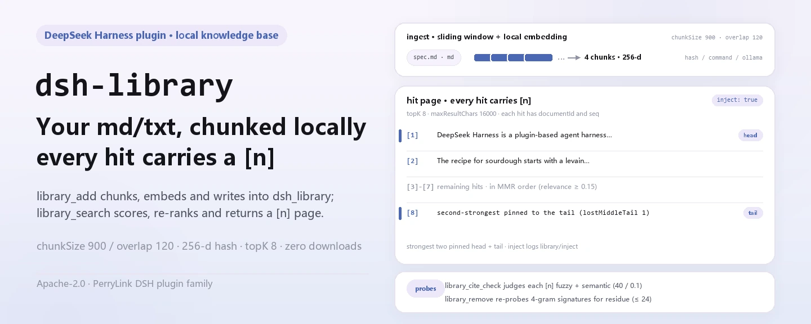
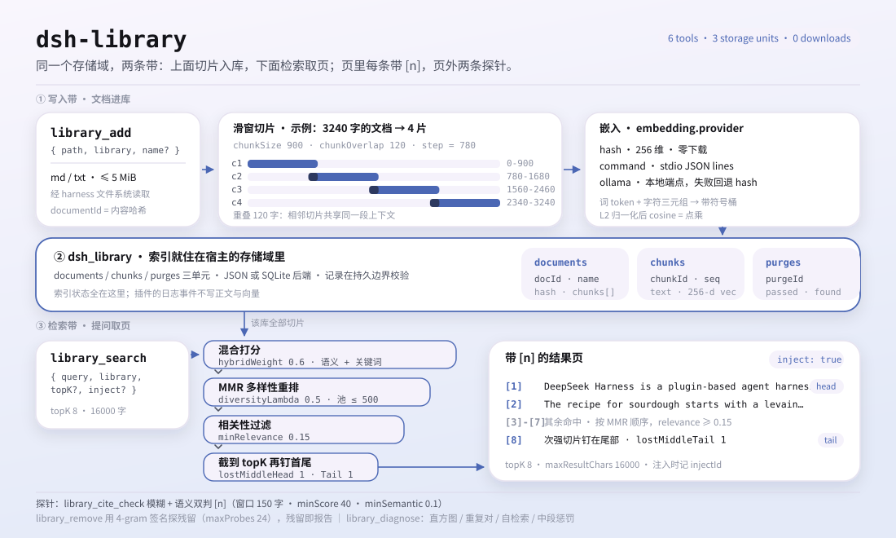

<div align="center">

<picture>
  <source media="(prefers-color-scheme: dark)" srcset="docs/assets/dsh-library-hero-en-dark.webp">
  
</picture>

# dsh-library

**Turn your local md/txt documents into a citable, verifiable retrieval library.**

A local document knowledge base for DeepSeek Harness: import by path, chunk with a sliding window, embed locally, and get hybrid search results whose `[n]` citations — and deletions — can be checked.

[Install](#three-step-setup) · [Configuration](#configuration) · [FAQ](#faq) · [简体中文](README.md) · [English](README.en.md) · [Español](README.es.md) · [Português](README.pt.md) · [हिन्दी](README.hi.md)

[](LICENSE)
[](#compatibility)
[](https://www.npmjs.com/package/dsh-library)
[](https://github.com/PerryLink/dsh-library/actions/workflows/ci.yml)
[](#compatibility)

[](https://github.com/PerryLink/dsh-library/stargazers)
[](https://www.npmjs.com/package/dsh-library)
[](https://dshfind.com/plugins/PerryLink/dsh-library?ref=badge)
[](https://securityscorecards.dev/viewer/?uri=github.com/PerryLink/dsh-library)
[](https://dsh.market/)
[](https://gitee.com/perrylink/dsh-library)

```sh
dsh plugin --profile <name> add dsh-library
```

</div>

<sub>Community plugin, not affiliated with DeepSeek. Canonical repository: <https://github.com/PerryLink/dsh-library> (Gitee is a mirror).</sub>

## What it is

`dsh-library` turns your md/txt documents into a local knowledge base your agent can query. `library_add` reads a document by path, chunks it with a sliding window, and writes it into the host's `dsh_library` storage domain; `library_search` combines semantic and keyword scoring, maximal-marginal-relevance diversity re-ranking, relevance filtering, and lost-in-the-middle avoidance to return a result page marked with `[n]` sources. Citations can be checked one by one with `library_cite_check`, and deletions are re-probed for residue by `library_remove`'s purge verification. Zero model downloads and zero network requests by default — scoring is deterministic hashing and token math.

<picture>
  <source media="(prefers-color-scheme: dark)" srcset="docs/assets/dsh-library-flow-v5-dark.svg">
  
</picture>

## Three-step setup

1. **Install** (pick one channel):

   ```sh
   # git channel (latest main) — the prepare script builds with production dependencies only
   dsh plugin --profile web add github:PerryLink/dsh-library
   # npm channel (published releases)
   dsh plugin --profile web add dsh-library
   # tarball channel: pnpm pack in this repo, then
   dsh plugin --profile web add ./dsh-library-<version>.tgz
   ```

   > If pnpm reports `ERR_PNPM_IGNORED_BUILDS` for this package (esbuild's harmless platform-binary validation), add `allowBuilds: { esbuild: true }` to your `pnpm-workspace.yaml` — the `dsh` CLI prints the exact snippet.

2. **Minimal config**: the defaults are enough — the bundle patch inserts the `dsh-library` row, and the index lives in the host's `dsh_library` storage domain (JSON or SQLite backend). You only need an override to change retrieval taste; see Configuration.

3. **Verify it mounts**:

   ```sh
   dsh --profile web --dump-config | grep -A2 'id: dsh-library'
   ```

   Then ask the agent to import and use a document:

   ```text
   > Add ./docs/spec.md to library docs, then answer: what does the spec say about retries? Cite [n] markers.
   ```

**Uninstall**: `dsh plugin --profile web remove dsh-library` (or remove the row from the profile patch).

<details>
<summary>Install from the DSH Desktop market</summary>

Every PerryLink plugin is listed in the built-in DSH Desktop market: **Market → Sources → Add source → paste** `https://perrylink-dsh-catalog.perrylink.workers.dev/catalog-source.json` **→ select**. Installation still requires the market's npm identity check and your confirmation.

</details>

## Core capabilities

`dsh-library` turns local md/txt documents into a queryable knowledge base with a quality pipeline your agent can trust:

- **`library_add` / `library_remove` / `library_list`** — import a document by path (chunked and embedded), remove one with **purge verification** (signatures of the removed content are probed against the remaining index and any residue is reported), and list document metadata.
- **`library_search`** — hybrid semantic + keyword ranking, maximal-marginal-relevance diversity re-rank, relevance filtering, and **lost-in-the-middle avoidance** (strongest chunks pinned to head and tail). With `inject: true` the result page is injected into the calling agent; every hit carries a `[n]` source marker and the injection is reconstructable from the `library/inject` session event (host-gated; see Permissions & data).
- **`library_cite_check`** — verify the `[n]` citations in an answer against the search result page with a fuzzy token match AND a semantic similarity check.
- **`library_diagnose`** — chunk-size histogram, near-duplicate chunk pairs, a self-retrieval probe, and the middle-penalty signal.
- **`/library`** — one-line index summaries per library.

### Commands & tools surface

| Tool | Notes |
|---|---|
| `library_add` | `{ path, library, name? }` → document id; file read through the harness filesystem service |
| `library_remove` | `{ library, documentId }` → removal summary + purge verdict (residue reported) |
| `library_list` | `{ library? }` → document metadata (never text) |
| `library_search` | `{ query, library, topK?, inject? }` → ranked hits with `[n]` markers; `inject: true` seeds the calling agent |
| `library_cite_check` | `{ library, query, answer }` → per-citation valid/invalid verdicts (fuzzy + semantic) |
| `library_diagnose` | `{ library }` → chunk stats, duplicates, self-retrieval, middle penalty |
| `/library [name]` | Command: per-library document/chunk summaries |

### Examples

These are the plugin's real entry points; install once, then call one.

**Detailed example**

**Command**

~~~sh
library_search({ library: "docs", query: "what is the harness built on", inject: true })
~~~

**Output**

~~~text
Library docs: 2 result(s) for "what is the harness built on"
[1] DeepSeek Harness is a plugin-based agent harness built on vendored Cordis. Everything in the harness is a plugin row inside a cordis.yml composition. The tools/pre-execute waterfall lets plugins gate…
[2] The recipe for sourdough starts with a levain fed the night before. Bulk fermentation takes four to six hours at room temperature. Bake in a dutch oven at 230 degrees Celsius for the first twenty min…
~~~

*Observed from `README.md:161-167; tests/index.spec.ts:46-64; src/index.ts:830-836`*

**Failure branch**

**Input**

~~~text
{"path":"/nonexistent/dsh-library-missing.txt","library":"docs"}
~~~

**Output**

~~~text
isError=true; error.message=cannot read "/nonexistent/dsh-library-missing.txt": not found; error.info={"name":"FsError","code":"FS_NOT_FOUND"}
~~~

*Observed from `plugins/dsh-library/src/index.ts:695-696 (fs.resolve/readText); plugins/dsh-library/tests/index.spec.ts:143-151 (unreadable path); plugins/dsh-library/README.md:195 (unreadable files fail loud); exercised through plugins/dsh-library/tests/harness.ts`*

**Brief examples**: `library_search` · `library_list`

## Configuration

All tunables are Schemastery `Config` fields (changeable from cordis.yml). An id-targeted override replaces the whole row — restate every key you need. `cordis.patch.yml` documents each key inline.

Most-used keys:

| Key | Default | Meaning |
|---|---|---|
| `chunkSize` | `900` | Sliding-window chunk size in characters (≤ 4000) |
| `chunkOverlap` | `120` | Overlap between consecutive windows; must be smaller than `chunkSize` |
| `maxFileBytes` | `5242880` | Files larger than this are rejected on `library_add` |
| `embedding.provider` | `hash` | Embedder backend: `hash` (built-in, zero downloads), `command` (external subprocess, requires `embedding.command`), or `ollama` (local Ollama, probed and degraded to `hash` when unreachable) |
| `search.topK` | `8` | Results returned after the full pipeline |
| `search.hybridWeight` | `0.6` | 0 = keyword-only, 1 = semantic-only |
| `search.minRelevance` | `0.15` | Chunks below this relevance threshold are filtered out |
| `injection.enabled` / `maxChars` | `true` / `12000` | `library_search` inject behavior and budget |

<details>
<summary>Full configuration table (18 key groups)</summary>

| Key | Default | Meaning |
|---|---|---|
| `chunkSize` | `900` | Sliding-window chunk size in characters (≤ 4000) |
| `chunkOverlap` | `120` | Overlap between consecutive windows; must be smaller than `chunkSize` |
| `maxFileBytes` | `5242880` | Files larger than this are rejected on `library_add` |
| `embedding.dims` | `256` | Hash-embedding dimensionality (≥ 8) |
| `embedding.provider` | `hash` | Embedder backend: `hash` (built-in, zero downloads), `command` (external subprocess, requires `embedding.command`), or `ollama` (local Ollama, probed and degraded to `hash` when unreachable) |
| `embedding.command` | `''` | Optional external embedder command (space-separated argv, no shell) over `ctx.subprocess`; setting it selects the `command` provider |
| `embedding.ollamaUrl` / `ollamaModel` | `http://127.0.0.1:11434` / `nomic-embed-text` | Local Ollama endpoint + model for the `ollama` provider (zero cloud) |
| `embedding.timeoutMs` / `graceMs` / `maxOutputBytes` / `maxBatchItems` | `30000` / `1000` / `1048576` / `64` | Embedder subprocess budget |
| `search.topK` | `8` | Results returned after the full pipeline |
| `search.hybridWeight` | `0.6` | 0 = keyword-only, 1 = semantic-only |
| `search.minRelevance` | `0.15` | Chunks below this relevance threshold are filtered out |
| `search.diversityLambda` | `0.5` | MMR trade-off: 1 = pure relevance, 0 = pure diversity |
| `search.lostMiddleHead` / `lostMiddleTail` | `1` / `1` | Strongest chunks pinned to head / tail |
| `search.maxResultChars` | `16000` | Character budget of the model-facing result page |
| `injection.enabled` / `maxChars` | `true` / `12000` | `library_search` inject behavior and budget |
| `citation.windowChars` / `minScore` / `minSemantic` | `150` / `40` / `0.1` | `library_cite_check` thresholds |
| `purge.signatureLength` / `maxProbes` | `4` / `24` | Purge verification signatures and probe budget |
| `diagnose.maxDuplicatePairs` / `sampleCap` / `positionBins` | `24` / `200` / `5` | `library_diagnose` budget caps |

</details>

Example override in your profile patch:

```yaml
- insert:
    - id: dsh-library
      name: dsh-library
      config:
        chunkSize: 900
        embedding:
          provider: ollama
          ollamaModel: nomic-embed-text
        search:
          hybridWeight: 0.7
```

## FAQ

<details>
<summary>Where do the document text and the index actually live? Can they reach the session log?</summary>

Chunk text and embeddings live in the host's storage backend (JSON or SQLite), with the same trust as the deployment's other durable data; the plugin adds no encryption. Document paths and embeddings never enter the session log — `library/inject` (id, query, chunk ids, page size) and `library/purge` (verdict) are log-only audit events, and the model-visible injected page is reconstructable from them. On hosts that record neither event type, the logged `tool/call` + `tool/result` events remain the reconstructable audit trail.

</details>

<details>
<summary>Does it work without a model or a network?</summary>

Yes. The built-in embedder is deterministic hashing (word tokens plus character tri-grams into a signed bucket vector, L2-normalized), so there are zero downloads and zero network requests; scoring is hashing and token math. The trade-off is lexical-grade semantics: retrieval quality on paraphrases is lower than a real embedding model — configure `embedding.command` (any subprocess embedder) or `embedding.provider: ollama` (a local Ollama model) for stronger semantics.

</details>

<details>
<summary>Is a removed document really gone?</summary>

`library_remove` does not assume success: it probes the remaining index with deterministic signatures of the removed content (`purge.signatureLength`, at most `purge.maxProbes` probes) and reports residue instead of claiming the content was purged.

</details>

<details>
<summary>Does it fight other plugins over tool names or services?</summary>

No. It only consumes host services (`storageDomain` / `tools` / `commands`); every tool it registers carries the `library_` prefix, its only command is `/library`, it registers no waterfall listener, and it provides no service key another plugin could contend for — so it occupies no bare tool name.

</details>

<details>
<summary>How big is the performance overhead?</summary>

The default path makes no model calls and no network requests; the cost is one sliding-window chunking pass plus hash embedding, then scoring and re-ranking at query time. The bounds are configurable: `maxFileBytes` caps document size, `search.topK` caps results, `search.maxResultChars` and `injection.maxChars` cap the model-visible text budget, and `library_diagnose` shows chunk distribution and duplicates on demand.

</details>

## Security boundaries

- **Local by default.** Zero model downloads, zero network calls — scoring is deterministic hashing and token math. Only an explicitly configured embedder command runs code, and its protocol is completeness-checked and output-capped.
- **No fabrication.** Citation checks report what the pipeline can verify; suspicious citations are surfaced honestly, never guessed.
- **Purge is verified.** `library_remove` probes the remaining index with deterministic signatures of the removed content and reports residue instead of assuming success.
- **Fail loud.** Invalid library names, oversized documents, unreadable files, and a configured-but-absent embedder seam all fail the call with a clear error.

## Permissions & data

- **Permissions**: the plugin only reads files you point `library_add` at (through the harness filesystem service and its policy) and writes into its own `dsh_library` storage domain. No network requests; an optional external embedder runs through `ctx.subprocess` without shell interpretation.
- **Data**: chunk text and embeddings live in the host's storage backend (same trust as the deployment's other durable data); the plugin adds no encryption. Document paths and embeddings never enter the session log.
- **Session log**: `library/inject` (id, query, chunk ids, page size) and `library/purge` (verdict) are log-only audit events — the model-visible injected page is reconstructable from them. The append is host-gated: harnesses whose known-type set covers the vocabulary get the events, `ignorable`-envelope builds get them with the marker, and envelope-less builds (0.1.1-rc.2, 0.1.2-rc.1) skip the append — the logged `tool/call` + `tool/result` events remain the reconstructable audit trail there.
0.1.2-rc.1 (adapted 2026-09-02): the session envelope keeps its ignorable field for stored-log read compatibility only - Session.append still cannot stamp it, so audit-gate behavior is unchanged.

## Known limitations

- **Lexical-grade embeddings.** The built-in hash embedder scores surface similarity, not meaning; retrieval quality on paraphrases is lower than a real embedding model — configure `embedding.command` (any subprocess embedder) or `embedding.provider: ollama` (a local Ollama embedding model) for stronger semantics.
- **Local citation model.** `library_cite_check` validates against the search result page (the `[n]` numbering), not against free-form source names; the fuzzy score is a bounded token-sequence partial ratio.
- **No ingestion pipeline.** Documents must be imported by path (`md`/`txt`); PDF/docx extraction is out of scope for v0.1.0.
- **Host-gated audit events.** `library/inject` / `library/purge` are only appended on harnesses that can carry them (see Permissions & data); on the published `0.1.2-rc.1` line (as on earlier envelope-less lines) they are not appended, and every fact stays reconstructable from the tool call/result log.

## Compatibility

| Surface | Status |
|---|---|
| Harness | DeepSeek Harness `dsh-v0.2.1-alpha.1` (verified 2026-09-25: dual typecheck rulers + 89 tests + self-contained/artifacts gates; peer range `>=0.1.2-rc.1 <0.2.0 \|\| >=0.1.5-alpha.1 <0.2.0 \|\| >=0.1.6-0 <0.2.0 \|\| >=0.1.7-0 <0.2.0`). Home of the family's only exercised alpha.2 host smoke (2026-09-11). |
| Node | `^22.19.0 \|\| >=24.0.0` |
| Storage | Any storage-domain backend (JSON or SQLite); the index lives in the host's storage domain |
| Models | None required — the built-in embedder is deterministic hashing (zero downloads) |

## Ecosystem & quality

- [Gitee mirror](https://gitee.com/perrylink/dsh-library) (sync mirror; GitHub is canonical)
- [dshfind plugin page](https://dshfind.com/plugins/PerryLink/dsh-library) (installs and ranking)
- [OpenSSF Scorecard report](https://securityscorecards.dev/viewer/?uri=github.com/PerryLink/dsh-library) (driven by [.github/workflows/scorecard.yml](.github/workflows/scorecard.yml))
- [dsh-plugin-doctor verification report](https://github.com/PerryLink/dsh-plugin-doctor#verified-徽章)
- [DSH Market](https://dsh.market/) (listed)
- **1024 store channel**: `npm i -g dsh1024` once, then `dsh1024 plugin --profile web add dsh-library` (counts toward the [deepseek1024.com](https://deepseek1024.com) install ranking)
- [Ecosystem knowledge base](https://perrylink.github.io/dsh-plugin-guide/) — measured data, not marketing: plugin development guide · plugin-selection data · maintenance criteria

## Development

```sh
pnpm install        # node ^22.19 || >=24
pnpm run typecheck  # tsc: src + tests against the local harness checkout
pnpm run typecheck:ci  # tsc against the published 0.1.7-rc.2 types (no paths)
pnpm test           # vitest: quality ports, core vocabulary, real-stack assembly
pnpm run build      # tsdown bundle + tsc declarations (lib/)
pnpm run verify:self-contained  # dependency specs resolve from the registry
pnpm run verify:artifacts       # built ESM face + bundle patch present
pnpm run check:readmes          # five-language README consistency
pnpm pack           # the published tarball
```

The README images are generated programmatically by [`scripts/gen-readme-assets.py`](scripts/gen-readme-assets.py): Pillow draws the hero banners (`docs/assets/dsh-library-hero-{zh,en}-{light,dark}.webp`) and a hand-written SVG draws the structure diagram (`docs/assets/dsh-library-flow-v5-{light,dark}.svg`); both are safe to re-run. The older single-panel flow diagram stays in `docs/assets/` for external links; the READMEs only reference the new hero and flow-v5 pairs.

Topics: `dsh`, `dsh-plugin`, `deepseek-harness`, `deepseek`, `cordis`, `rag`, `knowledge-base`, `retrieval`, `embedding`, `vector-search`, `citation-validation`, `document-library`

## Family & thanks

This project is part of the DeepSeek Harness plugin family from [PerryLink](https://github.com/PerryLink) (95 plugins, all Apache-2.0). If it is useful, **a star helps the next person find it** — nothing is gated behind it.

- [@PerryLink](https://github.com/PerryLink) — creator and maintainer: the eight quality ports, storage-domain index, hybrid retrieval pipeline, citation/purge verification, and the five-language docs.

<details>
<summary>Expand all plugins</summary>

| Plugin | Status |
|---|---|
| **[dsh-aqua-input-check](https://github.com/PerryLink/dsh-aqua-input-check)** |  |
| **[dsh-archive-check](https://github.com/PerryLink/dsh-archive-check)** |  |
| **[dsh-auto-review](https://github.com/PerryLink/dsh-auto-review)** |  |
| **[dsh-autotier](https://github.com/PerryLink/dsh-autotier)** | 🧊 FROZEN — see the repo README |
| **[dsh-bid-ca-precheck](https://github.com/PerryLink/dsh-bid-ca-precheck)** |  |
| **[dsh-bid-qual-check](https://github.com/PerryLink/dsh-bid-qual-check)** |  |
| **[dsh-cert-mcp](https://github.com/PerryLink/dsh-cert-mcp)** | 🧊 FROZEN — see the repo README |
| **[dsh-checkpoint-rewind](https://github.com/PerryLink/dsh-checkpoint-rewind)** |  |
| **[dsh-click](https://github.com/PerryLink/dsh-click)** |  |
| **[dsh-composer-history](https://github.com/PerryLink/dsh-composer-history)** |  |
| **[dsh-contract-stance](https://github.com/PerryLink/dsh-contract-stance)** |  |
| **[dsh-customs-doc-check](https://github.com/PerryLink/dsh-customs-doc-check)** |  |
| **[dsh-data-quality](https://github.com/PerryLink/dsh-data-quality)** | 🧊 FROZEN — see the repo README |
| **[dsh-demurrage-ledger](https://github.com/PerryLink/dsh-demurrage-ledger)** |  |
| **[dsh-doublecheck](https://github.com/PerryLink/dsh-doublecheck)** |  |
| **[dsh-drill-script-check](https://github.com/PerryLink/dsh-drill-script-check)** |  |
| **[dsh-eia-guide-check](https://github.com/PerryLink/dsh-eia-guide-check)** |  |
| **[dsh-emergency-plan](https://github.com/PerryLink/dsh-emergency-plan)** |  |
| **[dsh-essay-rubric-check](https://github.com/PerryLink/dsh-essay-rubric-check)** |  |
| **[dsh-evidence-check](https://github.com/PerryLink/dsh-evidence-check)** |  |
| **[dsh-export-ctl-check](https://github.com/PerryLink/dsh-export-ctl-check)** |  |
| **[dsh-fast](https://github.com/PerryLink/dsh-fast)** |  |
| **[dsh-fmea-table-check](https://github.com/PerryLink/dsh-fmea-table-check)** |  |
| **[dsh-forecast-penalty](https://github.com/PerryLink/dsh-forecast-penalty)** |  |
| **[dsh-fund-research](https://github.com/PerryLink/dsh-fund-research)** |  |
| **[dsh-github](https://github.com/PerryLink/dsh-github)** |  |
| **[dsh-gongwen-flow-check](https://github.com/PerryLink/dsh-gongwen-flow-check)** |  |
| **[dsh-gongwen-word-check](https://github.com/PerryLink/dsh-gongwen-word-check)** |  |
| **[dsh-guard-plan-qc](https://github.com/PerryLink/dsh-guard-plan-qc)** |  |
| **[dsh-hazchem-check](https://github.com/PerryLink/dsh-hazchem-check)** |  |
| **[dsh-hazplan-check](https://github.com/PerryLink/dsh-hazplan-check)** |  |
| **[dsh-hidden-risk-map](https://github.com/PerryLink/dsh-hidden-risk-map)** |  |
| **[dsh-hs-classify](https://github.com/PerryLink/dsh-hs-classify)** |  |
| **[dsh-icd-rule-check](https://github.com/PerryLink/dsh-icd-rule-check)** |  |
| **[dsh-industry-research](https://github.com/PerryLink/dsh-industry-research)** |  |
| **[dsh-lawcite-adapter](https://github.com/PerryLink/dsh-lawcite-adapter)** |  |
| **[dsh-laya](https://github.com/PerryLink/dsh-laya)** |  |
| **[dsh-lc-doc-check](https://github.com/PerryLink/dsh-lc-doc-check)** |  |
| **[dsh-learning-gap-check](https://github.com/PerryLink/dsh-learning-gap-check)** |  |
| **[dsh-library](https://github.com/PerryLink/dsh-library)** |  |
| **[dsh-local-ai](https://github.com/PerryLink/dsh-local-ai)** |  |
| **[dsh-lsp-actions](https://github.com/PerryLink/dsh-lsp-actions)** |  |
| **[dsh-mask](https://github.com/PerryLink/dsh-mask)** |  |
| **[dsh-mcp-panel](https://github.com/PerryLink/dsh-mcp-panel)** |  |
| **[dsh-medrec-qc](https://github.com/PerryLink/dsh-medrec-qc)** |  |
| **[dsh-memento](https://github.com/PerryLink/dsh-memento)** | 🧊 FROZEN — see the repo README |
| **[dsh-nsfc-form-check](https://github.com/PerryLink/dsh-nsfc-form-check)** |  |
| **[dsh-nurse-record-check](https://github.com/PerryLink/dsh-nurse-record-check)** |  |
| **[dsh-observe](https://github.com/PerryLink/dsh-observe)** |  |
| **[dsh-origin-rvc-check](https://github.com/PerryLink/dsh-origin-rvc-check)** |  |
| **[dsh-ota-review-check](https://github.com/PerryLink/dsh-ota-review-check)** |  |
| **[dsh-output-styles](https://github.com/PerryLink/dsh-output-styles)** |  |
| **[dsh-paper-doc-adapter](https://github.com/PerryLink/dsh-paper-doc-adapter)** |  |
| **[dsh-permission-rules](https://github.com/PerryLink/dsh-permission-rules)** |  |
| **[dsh-permit-report-check](https://github.com/PerryLink/dsh-permit-report-check)** |  |
| **[dsh-pipeline-check](https://github.com/PerryLink/dsh-pipeline-check)** |  |
| **[dsh-pleading-draft](https://github.com/PerryLink/dsh-pleading-draft)** |  |
| **[dsh-plugin-doctor](https://github.com/PerryLink/dsh-plugin-doctor)** | 🚫 RETIRED (repo archived) |
| **[dsh-plugin-guide](https://github.com/PerryLink/dsh-plugin-guide)** |  |
| **[dsh-plugin-kit](https://github.com/PerryLink/dsh-plugin-kit)** | 🚫 RETIRED (repo archived) |
| **[dsh-plugin-upgrade](https://github.com/PerryLink/dsh-plugin-upgrade)** | 🚫 RETIRED (repo archived) |
| **[dsh-policy-brief-draft](https://github.com/PerryLink/dsh-policy-brief-draft)** |  |
| **[dsh-power-loss-split](https://github.com/PerryLink/dsh-power-loss-split)** |  |
| **[dsh-power-ticket-check](https://github.com/PerryLink/dsh-power-ticket-check)** |  |
| **[dsh-ppap-check](https://github.com/PerryLink/dsh-ppap-check)** |  |
| **[dsh-protest-deadline](https://github.com/PerryLink/dsh-protest-deadline)** |  |
| **[dsh-railway-window](https://github.com/PerryLink/dsh-railway-window)** |  |
| **[dsh-repair-order-qc](https://github.com/PerryLink/dsh-repair-order-qc)** |  |
| **[dsh-research-report](https://github.com/PerryLink/dsh-research-report)** |  |
| **[dsh-review-reply-check](https://github.com/PerryLink/dsh-review-reply-check)** |  |
| **[dsh-rulefile-check](https://github.com/PerryLink/dsh-rulefile-check)** |  |
| **[dsh-safety-brief-check](https://github.com/PerryLink/dsh-safety-brief-check)** |  |
| **[dsh-score](https://github.com/PerryLink/dsh-score)** | 🧊 FROZEN — see the repo README |
| **[dsh-session-sync](https://github.com/PerryLink/dsh-session-sync)** |  |
| **[dsh-site-log-check](https://github.com/PerryLink/dsh-site-log-check)** |  |
| **[dsh-skill-pack-security](https://github.com/PerryLink/dsh-skill-pack-security)** |  |
| **[dsh-soe-decision-check](https://github.com/PerryLink/dsh-soe-decision-check)** |  |
| **[dsh-soilwater-check](https://github.com/PerryLink/dsh-soilwater-check)** |  |
| **[dsh-sop-sync-check](https://github.com/PerryLink/dsh-sop-sync-check)** |  |
| **[dsh-spc-gbt-adapter](https://github.com/PerryLink/dsh-spc-gbt-adapter)** |  |
| **[dsh-talk](https://github.com/PerryLink/dsh-talk)** |  |
| **[dsh-tender-extract](https://github.com/PerryLink/dsh-tender-extract)** |  |
| **[dsh-tender-matrix](https://github.com/PerryLink/dsh-tender-matrix)** |  |
| **[dsh-test-drive](https://github.com/PerryLink/dsh-test-drive)** |  |
| **[dsh-ticktick](https://github.com/PerryLink/dsh-ticktick)** | 🚫 RETIRED (repo archived) |
| **[dsh-translate](https://github.com/PerryLink/dsh-translate)** |  |
| **[dsh-warranty-calc](https://github.com/PerryLink/dsh-warranty-calc)** |  |
| **[dsh-budget](https://github.com/PerryLink/dsh-budget)** | 🧊 FROZEN — see the repo README |
| **[dsh-claude-move](https://github.com/PerryLink/dsh-claude-move)** | 🧊 FROZEN — see the repo README |
| **[dsh-defend](https://github.com/PerryLink/dsh-defend)** | 🧊 FROZEN — see the repo README |
| **[dsh-draw](https://github.com/PerryLink/dsh-draw)** | 🧊 FROZEN — see the repo README |
| **[dsh-reach](https://github.com/PerryLink/dsh-reach)** | 🧊 FROZEN — see the repo README |
| **[dsh-background-agents](https://github.com/PerryLink/dsh-background-agents)** | 🚫 RETIRED (repo archived) |
| **[dsh-session-pin](https://github.com/PerryLink/dsh-session-pin)** | 🚫 RETIRED (repo archived) |
| **[dsh-team-rooms](https://github.com/PerryLink/dsh-team-rooms)** | 🚫 RETIRED (repo archived) |

</details>

## License

[LICENSE](LICENSE) (Apache License 2.0) © 2026 dsh-library contributors

<p align="center"><sub>Apache-2.0 · Community plugin, not affiliated with DeepSeek.</sub></p>
