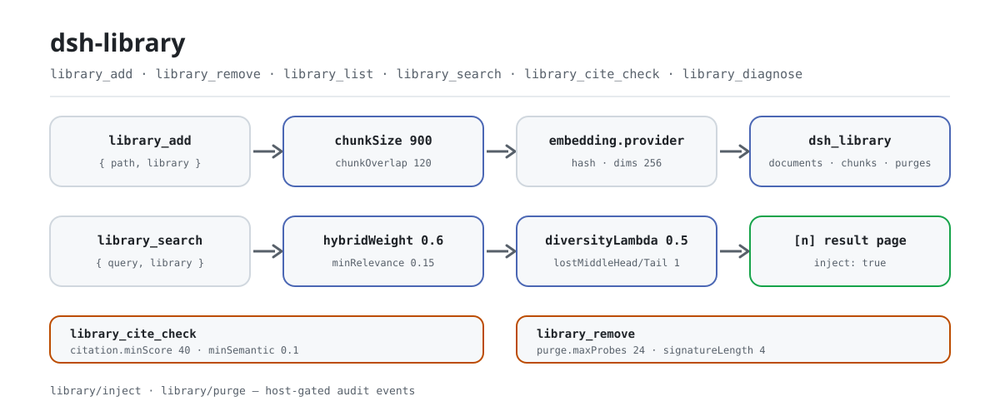

<div align="center">

<picture>
  <source media="(prefers-color-scheme: dark)" srcset="docs/assets/dsh-library-flow-dark.svg">
  
</picture>

# dsh-library

**Convierte tus documentos md/txt locales en una biblioteca de recuperación citable y verificable.**

Una base de conocimiento local de documentos para DeepSeek Harness: importa por ruta, trocea con ventana deslizante, incrusta localmente y obtén resultados de búsqueda híbrida cuyas citas `[n]` —y cuyas eliminaciones— se pueden comprobar.

[Instalar](#instalación-en-tres-pasos) · [Configuración](#configuración) · [FAQ](#faq) · [简体中文](README.md) · [English](README.en.md) · [Español](README.es.md) · [Português](README.pt.md) · [हिन्दी](README.hi.md)

[](LICENSE)
[](#compatibilidad)
[](https://www.npmjs.com/package/dsh-library)
[](https://github.com/PerryLink/dsh-library/actions/workflows/ci.yml)
[](#compatibilidad)

[](https://github.com/PerryLink/dsh-library/stargazers)
[](https://www.npmjs.com/package/dsh-library)
[](https://dshfind.com/plugins/PerryLink/dsh-library?ref=badge)
[](https://securityscorecards.dev/viewer/?uri=github.com/PerryLink/dsh-library)
[](https://dsh.market/)
[](https://gitee.com/perrylink/dsh-library)

```sh
dsh plugin --profile <name> add dsh-library
```

</div>

<sub>Plugin de la comunidad, no afiliado a DeepSeek. Repositorio canónico: <https://github.com/PerryLink/dsh-library> (Gitee es un espejo).</sub>

## Qué es

`dsh-library` convierte tus documentos md/txt en una base de conocimiento local que tu agente puede consultar. `library_add` lee un documento por ruta, lo trocea con una ventana deslizante y lo escribe en el dominio de almacenamiento `dsh_library` del host; `library_search` combina puntuación semántica y por palabras clave, re-ranking por diversidad de máxima relevancia marginal, filtrado por relevancia y evitación del lost-in-the-middle para devolver una página de resultados marcada con fuentes `[n]`. Las citas se comprueban una a una con `library_cite_check`, y las eliminaciones se vuelven a sondear en busca de residuos con la verificación de purga de `library_remove`. Cero descargas de modelos y cero peticiones de red por defecto: la puntuación es hash determinista y matemática de tokens.

## Instalación en tres pasos

1. **Instala** (elige un canal):

   ```sh
   # canal git (último main) — el script prepare compila solo con dependencias de producción
   dsh plugin --profile web add github:PerryLink/dsh-library
   # canal npm (versiones publicadas)
   dsh plugin --profile web add dsh-library
   # canal tarball: pnpm pack en este repositorio y luego
   dsh plugin --profile web add ./dsh-library-<version>.tgz
   ```

   > Si pnpm informa `ERR_PNPM_IGNORED_BUILDS` para este paquete (la validación inofensiva del binario de plataforma de esbuild), añade `allowBuilds: { esbuild: true }` a tu `pnpm-workspace.yaml` — el CLI `dsh` imprime el fragmento exacto.

2. **Configuración mínima**: los valores por defecto bastan — el parche del bundle inserta la fila `dsh-library` y el índice vive en el dominio de almacenamiento `dsh_library` del host (backend JSON o SQLite). Solo necesitas una sobrescritura para cambiar el criterio de recuperación; ver Configuración.

3. **Verifica que monta**:

   ```sh
   dsh --profile web --dump-config | grep -A2 'id: dsh-library'
   ```

   Luego pide al agente que importe y use un documento:

   ```text
   > Añade ./docs/spec.md a la biblioteca docs y responde: ¿qué dice la spec sobre reintentos? Cita con marcadores [n].
   ```

**Desinstalar**: `dsh plugin --profile web remove dsh-library` (o elimina la fila del parche del perfil).

<details>
<summary>Instalar desde el mercado de DSH Desktop</summary>

Todos los plugins de PerryLink pueden explorarse en el mercado integrado de DSH Desktop: **Market → Sources → add source → pegar** `https://perrylink-dsh-catalog.perrylink.workers.dev/catalog-source.json` **→ seleccionarlo**. La instalación sigue pasando por la verificación de identidad npm del mercado y tu confirmación.

</details>

## Capacidades clave

`dsh-library` convierte documentos md/txt locales en una base de conocimiento consultable con un pipeline de calidad en el que tu agente puede confiar:

- **`library_add` / `library_remove` / `library_list`** — importa un documento por ruta (troceado e incrustado), elimina uno con **verificación de purga** (las firmas del contenido eliminado se sondean contra el índice restante y cualquier residuo se reporta) y lista los metadatos de los documentos.
- **`library_search`** — ranking híbrido semántico + palabras clave, re-ranking por diversidad de máxima relevancia marginal, filtrado por relevancia y **evitación del lost-in-the-middle** (los chunks más fuertes se fijan a la cabeza y la cola). Con `inject: true` la página de resultados se inyecta en el agente que llama; cada resultado lleva un marcador `[n]` y la inyección es reconstruible desde el evento de sesión `library/inject` (condicionado por el host; ver Permisos y datos).
- **`library_cite_check`** — verifica las citas `[n]` de una respuesta contra la página de resultados con una coincidencia difusa de tokens Y una comprobación de similitud semántica.
- **`library_diagnose`** — histograma de tamaños de chunk, pares de chunks casi duplicados, una sonda de auto-recuperación y la señal de penalización media.
- **`/library`** — resúmenes del índice por biblioteca en una línea.

```text
documento ── library_add ─▶ chunk (ventana deslizante) ─▶ embed (hash / comando externo)
                                     │
                        dominio de almacenamiento (documents / chunks / purges)
                                     │
consulta ── library_search ─▶ puntuación híbrida ─▶ re-rank MMR ─▶ filtro de relevancia
                                     │                        ─▶ orden lost-in-middle
                                     ▼
                    página de resultados con marcadores [n] ── inject: true ─▶ agente + evento library/inject (condicionado por el host)
```

### Superficie de comandos y herramientas

| Herramienta | Notas |
|---|---|
| `library_add` | `{ path, library, name? }` → id del documento; lectura a través del servicio de archivos del harness |
| `library_remove` | `{ library, documentId }` → resumen de eliminación + veredicto de purga (residuo reportado) |
| `library_list` | `{ library? }` → metadatos de documentos (nunca texto) |
| `library_search` | `{ query, library, topK?, inject? }` → resultados ordenados con marcadores `[n]`; `inject: true` siembra el agente que llama |
| `library_cite_check` | `{ library, query, answer }` → veredictos por cita válida/inválida (difuso + semántico) |
| `library_diagnose` | `{ library }` → estadísticas de chunks, duplicados, auto-recuperación, penalización media |
| `/library [name]` | Comando: resúmenes de documentos/chunks por biblioteca |

### Ejemplos

Son los puntos de entrada reales; instala y llama a uno.

**Ejemplo detallado**

**Comando**

~~~sh
library_search({ library: "docs", query: "what is the harness built on", inject: true })
~~~

**Salida**

~~~text
Library docs: 2 result(s) for "what is the harness built on"
[1] DeepSeek Harness is a plugin-based agent harness built on vendored Cordis. Everything in the harness is a plugin row inside a cordis.yml composition. The tools/pre-execute waterfall lets plugins gate…
[2] The recipe for sourdough starts with a levain fed the night before. Bulk fermentation takes four to six hours at room temperature. Bake in a dutch oven at 230 degrees Celsius for the first twenty min…
~~~

*Observed from `README.md:161-167; tests/index.spec.ts:46-64; src/index.ts:830-836`*

**Rama de fallo**

**Entrada**

~~~text
{"path":"/nonexistent/dsh-library-missing.txt","library":"docs"}
~~~

**Salida**

~~~text
isError=true; error.message=cannot read "/nonexistent/dsh-library-missing.txt": not found; error.info={"name":"FsError","code":"FS_NOT_FOUND"}
~~~

*Observed from `plugins/dsh-library/src/index.ts:695-696 (fs.resolve/readText); plugins/dsh-library/tests/index.spec.ts:143-151 (unreadable path); plugins/dsh-library/README.md:195 (unreadable files fail loud); exercised through plugins/dsh-library/tests/harness.ts`*

**Ejemplos breves**: `library_search` · `library_list`

## Configuración

Todos los ajustes son campos `Config` de Schemastery (modificables desde cordis.yml). Una sobrescritura dirigida por id reemplaza toda la fila — vuelve a declarar cada clave que necesites. `cordis.patch.yml` documenta cada clave en línea.

Claves más usadas:

| Clave | Por defecto | Significado |
|---|---|---|
| `chunkSize` | `900` | Tamaño del chunk en caracteres (ventana deslizante, ≤ 4000) |
| `chunkOverlap` | `120` | Solapamiento entre ventanas; debe ser menor que `chunkSize` |
| `maxFileBytes` | `5242880` | Archivos mayores se rechazan en `library_add` |
| `embedding.provider` | `hash` | Backend del embedder: `hash` (integrado, cero descargas), `command` (subproceso externo, requiere `embedding.command`), `ollama` (Ollama local, probado y degradado a `hash` si es inalcanzable) |
| `search.topK` | `8` | Resultados devueltos tras el pipeline completo |
| `search.hybridWeight` | `0.6` | 0 = solo palabras clave, 1 = solo semántica |
| `search.minRelevance` | `0.15` | Los chunks bajo este umbral de relevancia se filtran |
| `injection.enabled` / `maxChars` | `true` / `12000` | Comportamiento y presupuesto de inyección de `library_search` |

<details>
<summary>Tabla de configuración completa (18 grupos de claves)</summary>

| Clave | Por defecto | Significado |
|---|---|---|
| `chunkSize` | `900` | Tamaño del chunk en caracteres (ventana deslizante, ≤ 4000) |
| `chunkOverlap` | `120` | Solapamiento entre ventanas; debe ser menor que `chunkSize` |
| `maxFileBytes` | `5242880` | Archivos mayores se rechazan en `library_add` |
| `embedding.dims` | `256` | Dimensionalidad del hash embedding (≥ 8) |
| `embedding.provider` | `hash` | Backend del embedder: `hash` (integrado, cero descargas), `command` (subproceso externo, requiere `embedding.command`), `ollama` (Ollama local, probado y degradado a `hash` si es inalcanzable) |
| `embedding.command` | `''` | Comando de embedder externo opcional (argv separado por espacios, sin shell) sobre `ctx.subprocess`; configurarlo selecciona el backend `command` |
| `embedding.ollamaUrl` / `ollamaModel` | `http://127.0.0.1:11434` / `nomic-embed-text` | Endpoint y modelo de Ollama local para el backend `ollama` (cero nube) |
| `embedding.timeoutMs` / `graceMs` / `maxOutputBytes` / `maxBatchItems` | `30000` / `1000` / `1048576` / `64` | Presupuesto del subproceso del embedder |
| `search.topK` | `8` | Resultados devueltos tras el pipeline completo |
| `search.hybridWeight` | `0.6` | 0 = solo palabras clave, 1 = solo semántica |
| `search.minRelevance` | `0.15` | Los chunks bajo este umbral de relevancia se filtran |
| `search.diversityLambda` | `0.5` | Compensación MMR: 1 = relevancia pura, 0 = diversidad pura |
| `search.lostMiddleHead` / `lostMiddleTail` | `1` / `1` | Chunks más fuertes fijados a la cabeza / cola |
| `search.maxResultChars` | `16000` | Presupuesto de caracteres de la página de resultados |
| `injection.enabled` / `maxChars` | `true` / `12000` | Comportamiento y presupuesto de inyección de `library_search` |
| `citation.windowChars` / `minScore` / `minSemantic` | `150` / `40` / `0.1` | Umbrales de `library_cite_check` |
| `purge.signatureLength` / `maxProbes` | `4` / `24` | Firmas y presupuesto de sondas de la verificación de purga |
| `diagnose.maxDuplicatePairs` / `sampleCap` / `positionBins` | `24` / `200` / `5` | Límites de `library_diagnose` |

</details>

Ejemplo de sobrescritura en el parche de tu perfil:

```yaml
- insert:
    - id: dsh-library
      name: dsh-library
      config:
        chunkSize: 900
        embedding:
          provider: ollama
          ollamaModel: nomic-embed-text
        search:
          hybridWeight: 0.7
```

## FAQ

<details>
<summary>¿Dónde viven realmente el texto de los documentos y el índice? ¿Pueden llegar al registro de sesión?</summary>

El texto de los chunks y los embeddings viven en el backend de almacenamiento del host (JSON o SQLite), con la misma confianza que el resto de los datos durables del despliegue; el plugin no añade cifrado. Las rutas de documentos y los embeddings nunca entran en el registro de sesión — `library/inject` (id, consulta, ids de chunks, tamaño de página) y `library/purge` (veredicto) son eventos de auditoría solo-registro, y la página inyectada visible para el modelo es reconstruible a partir de ellos. En hosts que no registran ninguno de esos tipos, los eventos registrados `tool/call` + `tool/result` siguen siendo el rastro de auditoría reconstruible.

</details>

<details>
<summary>¿Funciona sin modelo ni red?</summary>

Sí. El embedder integrado es hash determinista (tokens de palabra más trigramas de caracteres en un vector de cubos con signo, normalizado L2), así que hay cero descargas y cero peticiones de red; la puntuación es hash y matemática de tokens. La contrapartida es una semántica de grado léxico: la calidad de recuperación en paráfrasis es menor que con un modelo real — configura `embedding.command` (cualquier embedder de subproceso) o `embedding.provider: ollama` (un modelo Ollama local) para semántica más fuerte.

</details>

<details>
<summary>¿Un documento eliminado desaparece de verdad?</summary>

`library_remove` no asume éxito: sondea el índice restante con firmas deterministas del contenido eliminado (`purge.signatureLength`, como máximo `purge.maxProbes` sondas) y reporta el residuo en lugar de afirmar que se purgó.

</details>

<details>
<summary>¿Compite con otros plugins por nombres de herramientas o servicios?</summary>

No. Solo consume servicios del host (`storageDomain` / `tools` / `commands`); todas las herramientas que registra llevan el prefijo `library_`, su único comando es `/library`, no registra ningún listener de waterfall y no ofrece ninguna clave de servicio por la que otro plugin pueda competir, así que no ocupa ningún nombre de herramienta desnudo.

</details>

<details>
<summary>¿Cuánto coste de rendimiento supone?</summary>

La ruta por defecto no hace llamadas a modelos ni peticiones de red; el coste es una pasada de troceado con ventana deslizante más el hash embedding, y luego la puntuación y el re-ranking en consulta. Los límites son configurables: `maxFileBytes` acota el tamaño del documento, `search.topK` acota los resultados, `search.maxResultChars` e `injection.maxChars` acotan el presupuesto de texto visible para el modelo, y `library_diagnose` muestra la distribución de chunks y los duplicados a demanda.

</details>

## Límites de seguridad

- **Local por defecto.** Cero descargas de modelos, cero llamadas de red — la puntuación es hash determinista y matemática de tokens. Solo un comando de embedder configurado explícitamente ejecuta código, y su protocolo se verifica por completitud y se limita en salida.
- **Sin fabricación.** Las comprobaciones de citas informan lo que el pipeline puede verificar; las citas sospechosas se muestran con honestidad, nunca se adivinan.
- **La purga se verifica.** `library_remove` sondea el índice restante con firmas deterministas del contenido eliminado e informa del residuo en lugar de asumir éxito.
- **Fallo ruidoso.** Nombres de biblioteca inválidos, documentos demasiado grandes, archivos ilegibles y un seam de embedder configurado pero ausente fallan con un error claro.

## Permisos y datos

- **Permisos**: el plugin solo lee los archivos a los que apunta `library_add` (a través del servicio de archivos del harness y su política) y escribe en su propio dominio de almacenamiento `dsh_library`. Sin peticiones de red; un embedder externo opcional se ejecuta por `ctx.subprocess` sin interpretación de shell.
- **Datos**: el texto de los chunks y los embeddings viven en el backend de almacenamiento del host (la misma confianza que el resto de los datos durables del despliegue); el plugin no añade cifrado. Las rutas de documentos y los embeddings nunca entran en el registro de sesión.
- **Registro de sesión**: `library/inject` (id, consulta, ids de chunks, tamaño de página) y `library/purge` (veredicto) son eventos de auditoría solo-registro — la página inyectada visible para el modelo es reconstruible a partir de ellos. El append está condicionado por el host: los harnesses cuyo conjunto de tipos conocidos cubre el vocabulario reciben los eventos, las builds con envoltura `ignorable` los reciben con el marcador, y las builds sin envoltura (0.1.1-rc.2, 0.1.2-rc.1) omiten el append — allí los eventos registrados `tool/call` + `tool/result` siguen siendo el rastro de auditoría reconstruible.
0.1.2-rc.1 (adaptado el 2026-09-02): el sobre de sesión conserva su campo ignorable solo para compatibilidad de lectura de logs almacenados - Session.append aún no puede estamparlo, por lo que el comportamiento de la puerta no cambia.

## Limitaciones conocidas

- **Embeddings de grado léxico.** El embedder hash integrado puntúa similitud superficial, no significado; la calidad de recuperación en paráfrasis es menor que con un modelo real — configura `embedding.command` (cualquier embedder de subproceso) o `embedding.provider: ollama` (un modelo de embedding Ollama local) para semántica más fuerte.
- **Modelo de citas local.** `library_cite_check` valida contra la página de resultados (la numeración `[n]`), no contra nombres de fuente libres; la puntuación difusa es una razón parcial de secuencias de tokens acotada.
- **Sin pipeline de ingesta.** Los documentos deben importarse por ruta (`md`/`txt`); la extracción de PDF/docx queda fuera de v0.1.0.
- **Eventos de auditoría condicionados por el host.** `library/inject` / `library/purge` solo se añaden en harnesses que pueden llevarlos (ver Permisos y datos); en la línea publicada `0.1.2-rc.1` (como en las líneas sin envoltura anteriores) no se añaden, y cada hecho sigue siendo reconstruible desde el registro de llamada/resultado de la herramienta.

## Compatibilidad

| Superficie | Estado |
|---|---|
| Harness | DeepSeek Harness `dsh-v0.2.1-alpha.1` (verificado el 2026-09-25: doble typecheck + 89 pruebas + puertas self-contained/artifacts; rango de peers `>=0.1.2-rc.1 <0.2.0 \|\| >=0.1.5-alpha.1 <0.2.0 \|\| >=0.1.6-0 <0.2.0 \|\| >=0.1.7-0 <0.2.0`). Único paquete de la familia con un smoke real de host alpha.2 (2026-09-11). |
| Node | `^22.19.0 \|\| >=24.0.0` |
| Almacenamiento | Cualquier backend de storage-domain (JSON o SQLite); el índice vive en el dominio de almacenamiento del host |
| Modelos | Ninguno requerido — el embedder integrado es hash determinista (cero descargas) |

## Ecosistema y calidad

- [Espejo en Gitee](https://gitee.com/perrylink/dsh-library) (espejo sincronizado; GitHub es el canónico)
- [Página del plugin en dshfind](https://dshfind.com/plugins/PerryLink/dsh-library) (instalaciones y ranking)
- [Informe de OpenSSF Scorecard](https://securityscorecards.dev/viewer/?uri=github.com/PerryLink/dsh-library) (impulsado por [.github/workflows/scorecard.yml](.github/workflows/scorecard.yml))
- [Informe de verificación de dsh-plugin-doctor](https://github.com/PerryLink/dsh-plugin-doctor#verified-徽章)
- [DSH Market](https://dsh.market/) (listado)
- **Canal de la tienda 1024**: `npm i -g dsh1024` una vez, luego `dsh1024 plugin --profile web add dsh-library` (cuenta para el ranking de instalaciones de [deepseek1024.com](https://deepseek1024.com))
- [Base de conocimiento del ecosistema](https://perrylink.github.io/dsh-plugin-guide/) — datos medidos, no marketing: guía de desarrollo · datos de selección · criterios de mantenimiento

## Desarrollo

```sh
pnpm install        # node ^22.19 || >=24
pnpm run typecheck  # tsc: src + tests contra el checkout local del harness
pnpm run typecheck:ci  # tsc contra los tipos publicados 0.1.7-rc.2 (sin paths)
pnpm test           # vitest: puertos de calidad, vocabulario núcleo, ensamblaje con pila real
pnpm run build      # bundle tsdown + declaraciones tsc (lib/)
pnpm run verify:self-contained  # las especificaciones de dependencias resuelven desde el registry
pnpm run verify:artifacts       # cara ESM construida + bundle patch presente
pnpm run check:readmes          # consistencia de los README en cinco idiomas
pnpm pack           # el tarball publicado
```

Las imágenes del README las genera programáticamente [`scripts/gen-readme-assets.py`](scripts/gen-readme-assets.py) (Python + Pillow): escribe el par hero `docs/assets/dsh-library-flow-{light,dark}.svg` y se puede volver a ejecutar sin riesgo.

Topics: `dsh`, `dsh-plugin`, `deepseek-harness`, `deepseek`, `cordis`, `rag`, `knowledge-base`, `retrieval`, `embedding`, `vector-search`, `citation-validation`, `document-library`

## Familia y agradecimientos

Este proyecto forma parte de la familia de plugins de DeepSeek Harness de [PerryLink](https://github.com/PerryLink) (95 plugins, todos Apache-2.0). Si te resulta útil, **dale una estrella**: no desbloquea nada, pero ayuda a que la siguiente persona lo encuentre.

- [@PerryLink](https://github.com/PerryLink) — creador y mantenedor: los ocho puertos de calidad, el índice de dominio de almacenamiento, el pipeline de recuperación híbrido, la verificación de citas/purga y la documentación en cinco idiomas.

<details>
<summary>Expandir todos los plugins</summary>

| Plugin | Estado |
|---|---|
| **[dsh-aqua-input-check](https://github.com/PerryLink/dsh-aqua-input-check)** |  |
| **[dsh-archive-check](https://github.com/PerryLink/dsh-archive-check)** |  |
| **[dsh-auto-review](https://github.com/PerryLink/dsh-auto-review)** |  |
| **[dsh-autotier](https://github.com/PerryLink/dsh-autotier)** | 🧊 CONGELADO — ver el README del repo |
| **[dsh-bid-ca-precheck](https://github.com/PerryLink/dsh-bid-ca-precheck)** |  |
| **[dsh-bid-qual-check](https://github.com/PerryLink/dsh-bid-qual-check)** |  |
| **[dsh-cert-mcp](https://github.com/PerryLink/dsh-cert-mcp)** | 🧊 CONGELADO — ver el README del repo |
| **[dsh-checkpoint-rewind](https://github.com/PerryLink/dsh-checkpoint-rewind)** |  |
| **[dsh-click](https://github.com/PerryLink/dsh-click)** |  |
| **[dsh-composer-history](https://github.com/PerryLink/dsh-composer-history)** |  |
| **[dsh-contract-stance](https://github.com/PerryLink/dsh-contract-stance)** |  |
| **[dsh-customs-doc-check](https://github.com/PerryLink/dsh-customs-doc-check)** |  |
| **[dsh-data-quality](https://github.com/PerryLink/dsh-data-quality)** | 🧊 CONGELADO — ver el README del repo |
| **[dsh-demurrage-ledger](https://github.com/PerryLink/dsh-demurrage-ledger)** |  |
| **[dsh-doublecheck](https://github.com/PerryLink/dsh-doublecheck)** |  |
| **[dsh-drill-script-check](https://github.com/PerryLink/dsh-drill-script-check)** |  |
| **[dsh-eia-guide-check](https://github.com/PerryLink/dsh-eia-guide-check)** |  |
| **[dsh-emergency-plan](https://github.com/PerryLink/dsh-emergency-plan)** |  |
| **[dsh-essay-rubric-check](https://github.com/PerryLink/dsh-essay-rubric-check)** |  |
| **[dsh-evidence-check](https://github.com/PerryLink/dsh-evidence-check)** |  |
| **[dsh-export-ctl-check](https://github.com/PerryLink/dsh-export-ctl-check)** |  |
| **[dsh-fast](https://github.com/PerryLink/dsh-fast)** |  |
| **[dsh-fmea-table-check](https://github.com/PerryLink/dsh-fmea-table-check)** |  |
| **[dsh-forecast-penalty](https://github.com/PerryLink/dsh-forecast-penalty)** |  |
| **[dsh-fund-research](https://github.com/PerryLink/dsh-fund-research)** |  |
| **[dsh-github](https://github.com/PerryLink/dsh-github)** |  |
| **[dsh-gongwen-flow-check](https://github.com/PerryLink/dsh-gongwen-flow-check)** |  |
| **[dsh-gongwen-word-check](https://github.com/PerryLink/dsh-gongwen-word-check)** |  |
| **[dsh-guard-plan-qc](https://github.com/PerryLink/dsh-guard-plan-qc)** |  |
| **[dsh-hazchem-check](https://github.com/PerryLink/dsh-hazchem-check)** |  |
| **[dsh-hazplan-check](https://github.com/PerryLink/dsh-hazplan-check)** |  |
| **[dsh-hidden-risk-map](https://github.com/PerryLink/dsh-hidden-risk-map)** |  |
| **[dsh-hs-classify](https://github.com/PerryLink/dsh-hs-classify)** |  |
| **[dsh-icd-rule-check](https://github.com/PerryLink/dsh-icd-rule-check)** |  |
| **[dsh-industry-research](https://github.com/PerryLink/dsh-industry-research)** |  |
| **[dsh-lawcite-adapter](https://github.com/PerryLink/dsh-lawcite-adapter)** |  |
| **[dsh-laya](https://github.com/PerryLink/dsh-laya)** |  |
| **[dsh-lc-doc-check](https://github.com/PerryLink/dsh-lc-doc-check)** |  |
| **[dsh-learning-gap-check](https://github.com/PerryLink/dsh-learning-gap-check)** |  |
| **[dsh-library](https://github.com/PerryLink/dsh-library)** |  |
| **[dsh-local-ai](https://github.com/PerryLink/dsh-local-ai)** |  |
| **[dsh-lsp-actions](https://github.com/PerryLink/dsh-lsp-actions)** |  |
| **[dsh-mask](https://github.com/PerryLink/dsh-mask)** |  |
| **[dsh-mcp-panel](https://github.com/PerryLink/dsh-mcp-panel)** |  |
| **[dsh-medrec-qc](https://github.com/PerryLink/dsh-medrec-qc)** |  |
| **[dsh-memento](https://github.com/PerryLink/dsh-memento)** | 🧊 CONGELADO — ver el README del repo |
| **[dsh-nsfc-form-check](https://github.com/PerryLink/dsh-nsfc-form-check)** |  |
| **[dsh-nurse-record-check](https://github.com/PerryLink/dsh-nurse-record-check)** |  |
| **[dsh-observe](https://github.com/PerryLink/dsh-observe)** |  |
| **[dsh-origin-rvc-check](https://github.com/PerryLink/dsh-origin-rvc-check)** |  |
| **[dsh-ota-review-check](https://github.com/PerryLink/dsh-ota-review-check)** |  |
| **[dsh-output-styles](https://github.com/PerryLink/dsh-output-styles)** |  |
| **[dsh-paper-doc-adapter](https://github.com/PerryLink/dsh-paper-doc-adapter)** |  |
| **[dsh-permission-rules](https://github.com/PerryLink/dsh-permission-rules)** |  |
| **[dsh-permit-report-check](https://github.com/PerryLink/dsh-permit-report-check)** |  |
| **[dsh-pipeline-check](https://github.com/PerryLink/dsh-pipeline-check)** |  |
| **[dsh-pleading-draft](https://github.com/PerryLink/dsh-pleading-draft)** |  |
| **[dsh-plugin-doctor](https://github.com/PerryLink/dsh-plugin-doctor)** | 🚫 RETIRADO (repo archivado) |
| **[dsh-plugin-guide](https://github.com/PerryLink/dsh-plugin-guide)** |  |
| **[dsh-plugin-kit](https://github.com/PerryLink/dsh-plugin-kit)** | 🚫 RETIRADO (repo archivado) |
| **[dsh-plugin-upgrade](https://github.com/PerryLink/dsh-plugin-upgrade)** | 🚫 RETIRADO (repo archivado) |
| **[dsh-policy-brief-draft](https://github.com/PerryLink/dsh-policy-brief-draft)** |  |
| **[dsh-power-loss-split](https://github.com/PerryLink/dsh-power-loss-split)** |  |
| **[dsh-power-ticket-check](https://github.com/PerryLink/dsh-power-ticket-check)** |  |
| **[dsh-ppap-check](https://github.com/PerryLink/dsh-ppap-check)** |  |
| **[dsh-protest-deadline](https://github.com/PerryLink/dsh-protest-deadline)** |  |
| **[dsh-railway-window](https://github.com/PerryLink/dsh-railway-window)** |  |
| **[dsh-repair-order-qc](https://github.com/PerryLink/dsh-repair-order-qc)** |  |
| **[dsh-research-report](https://github.com/PerryLink/dsh-research-report)** |  |
| **[dsh-review-reply-check](https://github.com/PerryLink/dsh-review-reply-check)** |  |
| **[dsh-rulefile-check](https://github.com/PerryLink/dsh-rulefile-check)** |  |
| **[dsh-safety-brief-check](https://github.com/PerryLink/dsh-safety-brief-check)** |  |
| **[dsh-score](https://github.com/PerryLink/dsh-score)** | 🧊 CONGELADO — ver el README del repo |
| **[dsh-session-sync](https://github.com/PerryLink/dsh-session-sync)** |  |
| **[dsh-site-log-check](https://github.com/PerryLink/dsh-site-log-check)** |  |
| **[dsh-skill-pack-security](https://github.com/PerryLink/dsh-skill-pack-security)** |  |
| **[dsh-soe-decision-check](https://github.com/PerryLink/dsh-soe-decision-check)** |  |
| **[dsh-soilwater-check](https://github.com/PerryLink/dsh-soilwater-check)** |  |
| **[dsh-sop-sync-check](https://github.com/PerryLink/dsh-sop-sync-check)** |  |
| **[dsh-spc-gbt-adapter](https://github.com/PerryLink/dsh-spc-gbt-adapter)** |  |
| **[dsh-talk](https://github.com/PerryLink/dsh-talk)** |  |
| **[dsh-tender-extract](https://github.com/PerryLink/dsh-tender-extract)** |  |
| **[dsh-tender-matrix](https://github.com/PerryLink/dsh-tender-matrix)** |  |
| **[dsh-test-drive](https://github.com/PerryLink/dsh-test-drive)** |  |
| **[dsh-ticktick](https://github.com/PerryLink/dsh-ticktick)** | 🚫 RETIRADO (repo archivado) |
| **[dsh-translate](https://github.com/PerryLink/dsh-translate)** |  |
| **[dsh-warranty-calc](https://github.com/PerryLink/dsh-warranty-calc)** |  |
| **[dsh-budget](https://github.com/PerryLink/dsh-budget)** | 🧊 CONGELADO — ver el README del repo |
| **[dsh-claude-move](https://github.com/PerryLink/dsh-claude-move)** | 🧊 CONGELADO — ver el README del repo |
| **[dsh-defend](https://github.com/PerryLink/dsh-defend)** | 🧊 CONGELADO — ver el README del repo |
| **[dsh-draw](https://github.com/PerryLink/dsh-draw)** | 🧊 CONGELADO — ver el README del repo |
| **[dsh-reach](https://github.com/PerryLink/dsh-reach)** | 🧊 CONGELADO — ver el README del repo |
| **[dsh-background-agents](https://github.com/PerryLink/dsh-background-agents)** | 🚫 RETIRADO (repo archivado) |
| **[dsh-session-pin](https://github.com/PerryLink/dsh-session-pin)** | 🚫 RETIRADO (repo archivado) |
| **[dsh-team-rooms](https://github.com/PerryLink/dsh-team-rooms)** | 🚫 RETIRADO (repo archivado) |

</details>

## Licencia

[LICENSE](LICENSE) (Apache License 2.0) © 2026 dsh-library contributors

<p align="center"><sub>Apache-2.0 · Plugin de la comunidad, no afiliado a DeepSeek.</sub></p>
