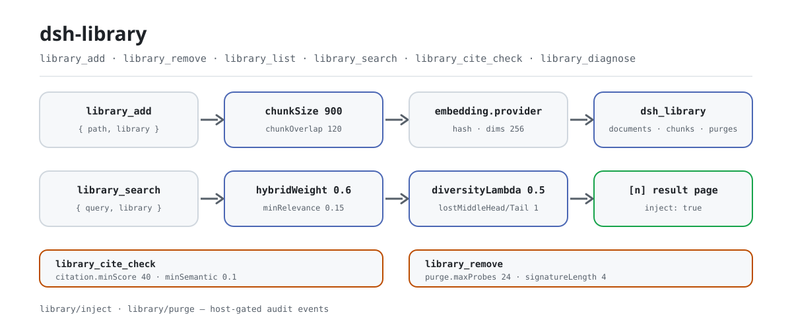

<div align="center">

<picture>
  <source media="(prefers-color-scheme: dark)" srcset="docs/assets/dsh-library-flow-dark.svg">
  
</picture>

# dsh-library

**अपने स्थानीय md/txt दस्तावेज़ों को उद्धरण-योग्य और सत्यापन-योग्य पुनर्प्राप्ति पुस्तकालय में बदलें।**

DeepSeek Harness के लिए स्थानीय दस्तावेज़ ज्ञानकोश: पथ से आयात, स्लाइडिंग विंडो चंकिंग, स्थानीय एम्बेडिंग, और हाइब्रिड खोज के ऐसे परिणाम जिनके `[n]` उद्धरण — और विलोपन — जाँचे जा सकते हैं।

[इंस्टॉल](#तीन-चरणों-में-शुरुआत) · [कॉन्फ़िगरेशन](#कॉन्फ़िगरेशन) · [FAQ](#faq) · [简体中文](README.md) · [English](README.en.md) · [Español](README.es.md) · [Português](README.pt.md) · [हिन्दी](README.hi.md)

[](LICENSE)
[](#संगतता)
[](https://www.npmjs.com/package/dsh-library)
[](https://github.com/PerryLink/dsh-library/actions/workflows/ci.yml)
[](#संगतता)

[](https://github.com/PerryLink/dsh-library/stargazers)
[](https://www.npmjs.com/package/dsh-library)
[](https://dshfind.com/plugins/PerryLink/dsh-library?ref=badge)
[](https://securityscorecards.dev/viewer/?uri=github.com/PerryLink/dsh-library)
[](https://dsh.market/)
[](https://gitee.com/perrylink/dsh-library)

```sh
dsh plugin --profile <name> add dsh-library
```

</div>

<sub>सामुदायिक प्लगइन, DeepSeek से असंबद्ध। कैनोनिकल रिपॉज़िटरी: <https://github.com/PerryLink/dsh-library> (Gitee एक मिरर है)।</sub>

## यह क्या है

`dsh-library` आपके md/txt दस्तावेज़ों को एक स्थानीय ज्ञानकोश में बदलता है जिसे आपका एजेंट क्वेरी कर सकता है। `library_add` पथ से दस्तावेज़ पढ़ता है, स्लाइडिंग विंडो से चंक करता है और होस्ट के `dsh_library` भंडारण डोमेन में लिखता है; `library_search` सिमेंटिक + कीवर्ड स्कोरिंग, MMR विविधता पुनः-क्रम, प्रासंगिकता फ़िल्टर और lost-in-the-middle बचाव को मिलाकर `[n]` स्रोत चिह्नों वाला परिणाम-पृष्ठ लौटाता है। उद्धरण `library_cite_check` से एक-एक करके जाँचे जाते हैं, और विलोपन `library_remove` के पर्ज सत्यापन से अवशेष के लिए फिर से जाँचे जाते हैं। डिफ़ॉल्ट रूप से शून्य मॉडल डाउनलोड और शून्य नेटवर्क अनुरोध — स्कोरिंग नियतात्मक हैश और टोकन गणित है।

## तीन चरणों में शुरुआत

1. **इंस्टॉल करें** (एक चैनल चुनें):

   ```sh
   # git चैनल (नवीनतम main) — prepare स्क्रिप्ट केवल उत्पादन निर्भरताओं से बिल्ड करती है
   dsh plugin --profile web add github:PerryLink/dsh-library
   # npm चैनल (प्रकाशित रिलीज़)
   dsh plugin --profile web add dsh-library
   # tarball चैनल: इस रेपो में pnpm pack के बाद
   dsh plugin --profile web add ./dsh-library-<version>.tgz
   ```

   > यदि pnpm इस पैकेज के लिए `ERR_PNPM_IGNORED_BUILDS` बताए (esbuild के प्लेटफ़ॉर्म-बाइनरी का हानिरहित सत्यापन), तो अपने `pnpm-workspace.yaml` में `allowBuilds: { esbuild: true }` जोड़ें — `dsh` CLI सटीक स्निपेट प्रिंट करता है।

2. **न्यूनतम कॉन्फ़िगरेशन**: डिफ़ॉल्ट मान ही काफ़ी हैं — बंडल पैच `dsh-library` पंक्ति स्वयं डालता है, और सूचकांक होस्ट के `dsh_library` भंडारण डोमेन (JSON या SQLite बैकएंड) में रहता है। रिट्रीवल का स्वाद बदलना हो तभी ओवरराइड चाहिए; कॉन्फ़िगरेशन देखें।

3. **सत्यापित करें कि यह माउंट हुआ**:

   ```sh
   dsh --profile web --dump-config | grep -A2 'id: dsh-library'
   ```

   फिर एजेंट से पहला दस्तावेज़ आयात करवाएँ और प्रश्न पूछें:

   ```text
   > ./docs/spec.md को docs पुस्तकालय में जोड़ें, फिर उत्तर दें: spec रिट्राई के बारे में क्या कहती है? [n] चिह्नों से उद्धृत करें।
   ```

**अनइंस्टॉल**: `dsh plugin --profile web remove dsh-library` (या प्रोफ़ाइल पैच से वह पंक्ति हटाएँ)।

<details>
<summary>DSH Desktop मार्केट से इंस्टॉल करें</summary>

सभी PerryLink प्लगइन DSH Desktop के अंतर्निहित मार्केट में देखे जा सकते हैं: **Market → Sources → add source → पेस्ट करें** `https://perrylink-dsh-catalog.perrylink.workers.dev/catalog-source.json` **→ चुनें**। इंस्टॉल अब भी मार्केट के npm पहचान-सत्यापन और आपकी पुष्टि से होता है।

</details>

## मुख्य क्षमताएँ

`dsh-library` स्थानीय md/txt दस्तावेज़ों को एक क्वेरी-योग्य ज्ञानकोश में बदलता है, साथ में एक गुणवत्ता पाइपलाइन जिस पर आपका एजेंट भरोसा कर सकता है:

- **`library_add` / `library_remove` / `library_list`** — पथ से दस्तावेज़ आयात करें (चंक + एम्बेड), **पर्ज सत्यापन** के साथ हटाएँ (हटाई गई सामग्री के हस्ताक्षर शेष सूचकांक पर जाँचे जाते हैं और कोई अवशेष रिपोर्ट होता है), और दस्तावेज़ मेटाडेटा सूचीबद्ध करें।
- **`library_search`** — सिमेंटिक + कीवर्ड हाइब्रिड रैंकिंग, अधिकतम सीमांत प्रासंगिकता विविधता पुनः-क्रम, प्रासंगिकता फ़िल्टर और **lost-in-the-middle बचाव** (सबसे मज़बूत चंक सिरे व पूँछ पर)। `inject: true` पर परिणाम-पृष्ठ कॉल करने वाले एजेंट में इंजेक्ट होता है; हर हिट पर `[n]` स्रोत चिह्न होता है और इंजेक्शन `library/inject` सत्र घटना से पुनर्निर्माण योग्य है (होस्ट-गेटेड; अनुमतियाँ और डेटा देखें)।
- **`library_cite_check`** — उत्तर के `[n]` उद्धरणों को परिणाम-पृष्ठ के विरुद्ध फ़ज़ी टोकन मिलान और सिमेंटिक समानता जाँच, दोनों से सत्यापित करता है।
- **`library_diagnose`** — चंक-आकार हिस्टोग्राम, लगभग-डुप्लिकेट चंक जोड़े, स्व-पुनर्प्राप्ति प्रोब और मध्य-दंड संकेत।
- **`/library`** — प्रति पुस्तकालय एक पंक्ति में सूचकांक सारांश।

```text
दस्तावेज़ ── library_add ─▶ चंक (स्लाइडिंग विंडो) ─▶ एम्बेड (हैश / बाहरी कमांड)
                                     │
                        भंडारण डोमेन (documents / chunks / purges)
                                     │
क्वेरी ── library_search ─▶ हाइब्रिड स्कोर ─▶ MMR पुनः-क्रम ─▶ प्रासंगिकता फ़िल्टर
                                     │                    ─▶ lost-in-middle क्रम
                                     ▼
                    [n] चिह्नों वाला परिणाम-पृष्ठ ── inject: true ─▶ एजेंट + library/inject घटना (होस्ट-गेटेड)
```

### कमांड और टूल सतह

| टूल | टिप्पणियाँ |
|---|---|
| `library_add` | `{ path, library, name? }` → दस्तावेज़ id; फ़ाइल harness फ़ाइल-सेवा से पढ़ी जाती है |
| `library_remove` | `{ library, documentId }` → हटाने का सारांश + पर्ज निर्णय (अवशेष रिपोर्ट) |
| `library_list` | `{ library? }` → दस्तावेज़ मेटाडेटा (कभी पाठ नहीं) |
| `library_search` | `{ query, library, topK?, inject? }` → `[n]` चिह्नों सहित क्रमबद्ध हिट; `inject: true` कॉल करने वाले एजेंट में बीज डालता है |
| `library_cite_check` | `{ library, query, answer }` → प्रति-उद्धरण वैध/अवैध निर्णय (फ़ज़ी + सिमेंटिक) |
| `library_diagnose` | `{ library }` → चंक आँकड़े, डुप्लिकेट, स्व-पुनर्प्राप्ति, मध्य-दंड |
| `/library [name]` | कमांड: प्रति पुस्तकालय दस्तावेज़/चंक सारांश |

### उदाहरण

ये प्लगइन के वास्तविक प्रवेश-बिंदु हैं; एक बार इंस्टॉल करें, फिर एक कॉल करें।

**विस्तृत उदाहरण**

**कमांड**

~~~sh
library_search({ library: "docs", query: "what is the harness built on", inject: true })
~~~

**आउटपुट**

~~~text
Library docs: 2 result(s) for "what is the harness built on"
[1] DeepSeek Harness is a plugin-based agent harness built on vendored Cordis. Everything in the harness is a plugin row inside a cordis.yml composition. The tools/pre-execute waterfall lets plugins gate…
[2] The recipe for sourdough starts with a levain fed the night before. Bulk fermentation takes four to six hours at room temperature. Bake in a dutch oven at 230 degrees Celsius for the first twenty min…
~~~

*Observed from `README.md:161-167; tests/index.spec.ts:46-64; src/index.ts:830-836`*

**विफलता शाखा**

**इनपुट**

~~~text
{"path":"/nonexistent/dsh-library-missing.txt","library":"docs"}
~~~

**आउटपुट**

~~~text
isError=true; error.message=cannot read "/nonexistent/dsh-library-missing.txt": not found; error.info={"name":"FsError","code":"FS_NOT_FOUND"}
~~~

*Observed from `plugins/dsh-library/src/index.ts:695-696 (fs.resolve/readText); plugins/dsh-library/tests/index.spec.ts:143-151 (unreadable path); plugins/dsh-library/README.md:195 (unreadable files fail loud); exercised through plugins/dsh-library/tests/harness.ts`*

**संक्षिप्त उदाहरण**: `library_search` · `library_list`

## कॉन्फ़िगरेशन

सभी समायोजन Schemastery `Config` फ़ील्ड हैं (cordis.yml से बदले जा सकते हैं)। id-लक्षित ओवरराइड पूरी पंक्ति बदल देता है — ज़रूरत की हर कुंजी फिर से लिखें। `cordis.patch.yml` हर कुंजी को इनलाइन समझाता है।

सबसे अधिक उपयोग होने वाली कुंजियाँ:

| कुंजी | डिफ़ॉल्ट | अर्थ |
|---|---|---|
| `chunkSize` | `900` | स्लाइडिंग-विंडो चंक आकार वर्णों में (≤ 4000) |
| `chunkOverlap` | `120` | लगातार विंडो के बीच ओवरलैप; `chunkSize` से छोटा होना चाहिए |
| `maxFileBytes` | `5242880` | इससे बड़ी फ़ाइलें `library_add` पर अस्वीकार होती हैं |
| `embedding.provider` | `hash` | एम्बेडर बैकएंड: `hash` (अंतर्निहित, शून्य डाउनलोड), `command` (बाहरी उपप्रक्रिया, `embedding.command` आवश्यक), `ollama` (स्थानीय Ollama, अनुपलब्ध होने पर `hash` में डिग्रेड) |
| `search.topK` | `8` | पूरी पाइपलाइन के बाद लौटे परिणाम |
| `search.hybridWeight` | `0.6` | 0 = केवल कीवर्ड, 1 = केवल सिमेंटिक |
| `search.minRelevance` | `0.15` | इस प्रासंगिकता सीमा से नीचे के चंक छाँटे जाते हैं |
| `injection.enabled` / `maxChars` | `true` / `12000` | `library_search` इंजेक्शन व्यवहार व बजट |

<details>
<summary>पूर्ण कॉन्फ़िगरेशन तालिका (18 कुंजी-समूह)</summary>

| कुंजी | डिफ़ॉल्ट | अर्थ |
|---|---|---|
| `chunkSize` | `900` | स्लाइडिंग-विंडो चंक आकार वर्णों में (≤ 4000) |
| `chunkOverlap` | `120` | लगातार विंडो के बीच ओवरलैप; `chunkSize` से छोटा होना चाहिए |
| `maxFileBytes` | `5242880` | इससे बड़ी फ़ाइलें `library_add` पर अस्वीकार होती हैं |
| `embedding.dims` | `256` | हैश-एम्बेडिंग आयाम (≥ 8) |
| `embedding.provider` | `hash` | एम्बेडर बैकएंड: `hash` (अंतर्निहित, शून्य डाउनलोड), `command` (बाहरी उपप्रक्रिया, `embedding.command` आवश्यक), `ollama` (स्थानीय Ollama, अनुपलब्ध होने पर `hash` में डिग्रेड) |
| `embedding.command` | `''` | वैकल्पिक बाहरी एम्बेडर कमांड (स्पेस-सेपरेटेड argv, कोई शेल नहीं) `ctx.subprocess` से; सेट करने पर `command` बैकएंड चयनित होता है |
| `embedding.ollamaUrl` / `ollamaModel` | `http://127.0.0.1:11434` / `nomic-embed-text` | `ollama` बैकएंड के लिए स्थानीय Ollama एंडपॉइंट व मॉडल (शून्य क्लाउड) |
| `embedding.timeoutMs` / `graceMs` / `maxOutputBytes` / `maxBatchItems` | `30000` / `1000` / `1048576` / `64` | एम्बेडर उपप्रक्रिया बजट |
| `search.topK` | `8` | पूरी पाइपलाइन के बाद लौटे परिणाम |
| `search.hybridWeight` | `0.6` | 0 = केवल कीवर्ड, 1 = केवल सिमेंटिक |
| `search.minRelevance` | `0.15` | इस प्रासंगिकता सीमा से नीचे के चंक छाँटे जाते हैं |
| `search.diversityLambda` | `0.5` | MMR संतुलन: 1 = शुद्ध प्रासंगिकता, 0 = शुद्ध विविधता |
| `search.lostMiddleHead` / `lostMiddleTail` | `1` / `1` | सबसे मज़बूत चंक शीर्ष / पूँछ पर |
| `search.maxResultChars` | `16000` | मॉडल-दृश्य परिणाम-पृष्ठ वर्ण बजट |
| `injection.enabled` / `maxChars` | `true` / `12000` | `library_search` इंजेक्शन व्यवहार व बजट |
| `citation.windowChars` / `minScore` / `minSemantic` | `150` / `40` / `0.1` | `library_cite_check` सीमाएँ |
| `purge.signatureLength` / `maxProbes` | `4` / `24` | पर्ज सत्यापन हस्ताक्षर व जाँच बजट |
| `diagnose.maxDuplicatePairs` / `sampleCap` / `positionBins` | `24` / `200` / `5` | `library_diagnose` बजट सीमाएँ |

</details>

प्रोफ़ाइल पैच में ओवरराइड का उदाहरण:

```yaml
- insert:
    - id: dsh-library
      name: dsh-library
      config:
        chunkSize: 900
        embedding:
          provider: ollama
          ollamaModel: nomic-embed-text
        search:
          hybridWeight: 0.7
```

## FAQ

<details>
<summary>दस्तावेज़ पाठ और सूचकांक वास्तव में कहाँ रहते हैं? क्या वे सत्र लॉग में जा सकते हैं?</summary>

चंक पाठ और एम्बेडिंग होस्ट के भंडारण बैकएंड (JSON या SQLite) में रहते हैं, डिप्लॉयमेंट के बाकी स्थायी डेटा जैसे ही भरोसे के साथ; प्लगइन कोई अतिरिक्त एन्क्रिप्शन नहीं जोड़ता। दस्तावेज़ पथ और एम्बेडिंग कभी सत्र लॉग में नहीं जाते — `library/inject` (id, क्वेरी, चंक ids, पृष्ठ आकार) और `library/purge` (निर्णय) केवल-लॉग ऑडिट घटनाएँ हैं, और मॉडल-दृश्य इंजेक्टेड पृष्ठ उनसे पुनर्निर्माण योग्य है। जो होस्ट इनमें से कोई घटना-प्रकार दर्ज नहीं करते, वहाँ लॉग किए गए `tool/call` + `tool/result` घटनाएँ ही पुनर्निर्माण योग्य ऑडिट-कड़ी बनी रहती हैं।

</details>

<details>
<summary>क्या यह बिना मॉडल या नेटवर्क के चलता है?</summary>

हाँ। अंतर्निहित एम्बेडर नियतात्मक हैश है (शब्द टोकन और वर्ण त्रि-ग्राम चिह्नित बकेट वेक्टर में, L2-सामान्यीकृत), इसलिए शून्य डाउनलोड और शून्य नेटवर्क अनुरोध हैं; स्कोरिंग हैश और टोकन गणित है। कीमत शाब्दिक-स्तर की सिमेंटिक्स है: व्याख्यात्मक वाक्यों पर पुनर्प्राप्ति गुणवत्ता वास्तविक एम्बेडिंग मॉडल से कम है — मज़बूत सिमेंटिक्स के लिए `embedding.command` (कोई भी उपप्रक्रिया एम्बेडर) या `embedding.provider: ollama` (स्थानीय Ollama मॉडल) कॉन्फ़िगर करें।

</details>

<details>
<summary>क्या हटाया गया दस्तावेज़ सचमुच चला जाता है?</summary>

`library_remove` सफलता मान नहीं लेता: वह हटाई गई सामग्री के नियतात्मक हस्ताक्षरों (`purge.signatureLength`, अधिकतम `purge.maxProbes` जाँच) से शेष सूचकांक को सोना करता है और साफ़ होने का दावा करने के बजाय अवशेष रिपोर्ट करता है।

</details>

<details>
<summary>क्या यह अन्य प्लगइनों से टूल नाम या सेवाओं के लिए टकराता है?</summary>

नहीं। यह केवल होस्ट सेवाएँ (`storageDomain` / `tools` / `commands`) उपभोग करता है; इसके द्वारा पंजीकृत हर टूल पर `library_` उपसर्ग है, इसका एकमात्र कमांड `/library` है, यह कोई waterfall लिसनर पंजीकृत नहीं करता और ऐसी कोई सेवा-कुंजी प्रदान नहीं करता जिस पर दूसरा प्लगइन होड़ कर सके — इसलिए यह कोई नंगा टूल नाम नहीं रोकता।

</details>

<details>
<summary>प्रदर्शन लागत कितनी है?</summary>

डिफ़ॉल्ट पथ में कोई मॉडल कॉल और कोई नेटवर्क अनुरोध नहीं है; लागत एक स्लाइडिंग-विंडो चंकिंग पास और हैश एम्बेडिंग है, फिर क्वेरी के समय स्कोरिंग व पुनः-क्रम। सीमाएँ कॉन्फ़िगर-योग्य हैं: `maxFileBytes` दस्तावेज़ आकार सीमित करता है, `search.topK` परिणाम सीमित करता है, `search.maxResultChars` और `injection.maxChars` मॉडल-दृश्य पाठ बजट सीमित करते हैं, और `library_diagnose` माँग पर चंक वितरण व डुप्लिकेट दिखाता है।

</details>

## सुरक्षा सीमाएँ

- **डिफ़ॉल्ट रूप से स्थानीय।** शून्य मॉडल डाउनलोड, शून्य नेटवर्क कॉल — स्कोरिंग नियतात्मक हैश व टोकन गणित है। केवल स्पष्ट रूप से कॉन्फ़िगर किया गया एम्बेडर कमांड कोड चलाता है, और उसका प्रोटोकॉल पूर्णता-जाँच और आउटपुट-सीमित है।
- **कोई मनगढ़ंत नहीं।** उद्धरण जाँच वही रिपोर्ट करती है जो पाइपलाइन सत्यापित कर सकती है; संदिग्ध उद्धरण ईमानदारी से दिखते हैं, अनुमान नहीं लगाए जाते।
- **पर्ज सत्यापित होता है।** `library_remove` हटाई गई सामग्री के नियतात्मक हस्ताक्षरों से शेष सूचकांक जाँचता है और सफलता मानने के बजाय अवशेष रिपोर्ट करता है।
- **ज़ोर से विफल।** अमान्य पुस्तकालय नाम, बहुत बड़े दस्तावेज़, अपठनीय फ़ाइलें और कॉन्फ़िगर-पर-अनुपस्थित एम्बेडर सीम स्पष्ट त्रुटि से विफल होते हैं।

## अनुमतियाँ और डेटा

- **अनुमतियाँ**: प्लगइन केवल वही फ़ाइलें पढ़ता है जिन्हें `library_add` इंगित करता है (harness फ़ाइल-सेवा और उसकी नीति से) और केवल अपने `dsh_library` भंडारण डोमेन में लिखता है। कोई नेटवर्क अनुरोध नहीं; वैकल्पिक बाहरी एम्बेडर `ctx.subprocess` से बिना शेल-व्याख्या चलता है।
- **डेटा**: चंक पाठ और एम्बेडिंग होस्ट के भंडारण बैकएंड में रहते हैं (डिप्लॉयमेंट के बाकी स्थायी डेटा जैसा ही भरोसा); प्लगइन कोई एन्क्रिप्शन नहीं जोड़ता। दस्तावेज़ पथ और एम्बेडिंग कभी सत्र लॉग में नहीं जाते।
- **सत्र लॉग**: `library/inject` (id, क्वेरी, चंक ids, पृष्ठ आकार) और `library/purge` (निर्णय) केवल-लॉग ऑडिट घटनाएँ हैं — मॉडल-दृश्य इंजेक्टेड पृष्ठ उनसे पुनर्निर्माण योग्य है। लिखावट होस्ट-गेटेड है: जिन हार्नेस का ज्ञात-प्रकार समूह शब्दावली को कवर करता है वे घटनाएँ पाते हैं, `ignorable`-लिफ़ाफ़े वाले बिल्ड उन्हें चिह्न के साथ पाते हैं, और लिफ़ाफ़ा-रहित बिल्ड (0.1.1-rc.2, 0.1.2-rc.1) लिखावट छोड़ देते हैं — वहाँ लॉग किए गए `tool/call` + `tool/result` घटनाएँ पुनर्निर्माण योग्य ऑडिट-कड़ी बनी रहती हैं।
0.1.2-rc.1 (2026-09-02 को अनुकूलित): सत्र लिफ़ाफ़ा अपना ignorable फ़ील्ड केवल संग्रहीत-लॉग पठन संगतता के लिए रखता है - Session.append अभी भी इसे स्टैम्प नहीं कर सकता, इसलिए गेट व्यवहार अपरिवर्तित है।

## ज्ञात सीमाएँ

- **शाब्दिक-स्तर एम्बेडिंग।** अंतर्निहित हैश एम्बेडर सतही समानता स्कोर करता है, अर्थ नहीं; व्याख्यात्मक वाक्यों पर पुनर्प्राप्ति गुणवत्ता वास्तविक मॉडल से कम है — मज़बूत सिमेंटिक्स के लिए `embedding.command` (कोई भी उपप्रक्रिया एम्बेडर) या `embedding.provider: ollama` (स्थानीय Ollama एम्बेडिंग मॉडल) कॉन्फ़िगर करें।
- **स्थानीय उद्धरण मॉडल।** `library_cite_check` परिणाम-पृष्ठ (`[n]` क्रमांकन) के विरुद्ध सत्यापित करता है, मुक्त स्रोत-नामों के विरुद्ध नहीं; फ़ज़ी स्कोर एक सीमित टोकन-अनुक्रम आंशिक अनुपात है।
- **कोई अंतर्ग्रहण पाइपलाइन नहीं।** दस्तावेज़ पथ से आयात होते हैं (`md`/`txt`); PDF/docx निष्कर्षण v0.1.0 के दायरे से बाहर है।
- **होस्ट-गेटेड ऑडिट घटनाएँ।** `library/inject` / `library/purge` केवल उन्हीं हार्नेस पर लिखी जाती हैं जो उन्हें सँभाल सकें (अनुमतियाँ और डेटा देखें); प्रकाशित `0.1.2-rc.1` लाइन पर (पहले की लिफ़ाफ़ा-रहित लाइनों की तरह) ये नहीं लिखी जातीं, और हर तथ्य टूल कॉल/परिणाम लॉग से पुनर्निर्माण योग्य रहता है।

## संगतता

| सतह | स्थिति |
|---|---|
| Harness | DeepSeek Harness `dsh-v0.2.1-alpha.1` (2026-09-25 को सत्यापित: दोहरी typecheck मापदंड + 89 परीक्षण + self-contained/artifacts द्वार; peer श्रेणी `>=0.1.2-rc.1 <0.2.0 \|\| >=0.1.5-alpha.1 <0.2.0 \|\| >=0.1.6-0 <0.2.0 \|\| >=0.1.7-0 <0.2.0`)। परिवार का एकमात्र पैकेज जिसका वास्तविक alpha.2 होस्ट स्मोक चला है (2026-09-11)। |
| Node | `^22.19.0 \|\| >=24.0.0` |
| भंडारण | कोई भी storage-domain बैकएंड (JSON या SQLite); सूचकांक होस्ट के भंडारण डोमेन में रहता है |
| मॉडल | कोई आवश्यक नहीं — अंतर्निहित एम्बेडर नियतात्मक हैश है (शून्य डाउनलोड) |

## इकोसिस्टम और गुणवत्ता

- [Gitee मिरर](https://gitee.com/perrylink/dsh-library) (सिंक मिरर; मानक GitHub है)
- [dshfind प्लगइन पृष्ठ](https://dshfind.com/plugins/PerryLink/dsh-library) (इंस्टॉल और रैंकिंग)
- [OpenSSF Scorecard रिपोर्ट](https://securityscorecards.dev/viewer/?uri=github.com/PerryLink/dsh-library) ([.github/workflows/scorecard.yml](.github/workflows/scorecard.yml) से संचालित)
- [dsh-plugin-doctor सत्यापन रिपोर्ट](https://github.com/PerryLink/dsh-plugin-doctor#verified-徽章)
- [DSH Market](https://dsh.market/) (सूचीबद्ध)
- **1024 स्टोर चैनल**: एक बार `npm i -g dsh1024`, फिर `dsh1024 plugin --profile web add dsh-library` ([deepseek1024.com](https://deepseek1024.com) की इंस्टॉल रैंकिंग में गिना जाता है)
- [इकोसिस्टम ज्ञानकोश](https://perrylink.github.io/dsh-plugin-guide/) — मापा गया डेटा, मार्केटिंग नहीं: प्लगइन विकास गाइड · चयन डेटा · रखरखाव मानदंड

## डेवलपमेंट

```sh
pnpm install        # node ^22.19 || >=24
pnpm run typecheck  # tsc: src + tests स्थानीय हार्नेस चेकआउट के विरुद्ध
pnpm run typecheck:ci  # tsc प्रकाशित 0.1.7-rc.2 प्रकारों के विरुद्ध (बिना paths)
pnpm test           # vitest: गुणवत्ता पोर्ट, मूल शब्दावली, वास्तविक-स्टैक संयोजन
pnpm run build      # tsdown बंडल + tsc घोषणाएँ (lib/)
pnpm run verify:self-contained  # निर्भरता स्पेक registry से हल होती हैं
pnpm run verify:artifacts       # निर्मित ESM फ़ेस + बंडल पैच मौजूद
pnpm run check:readmes          # पाँच भाषाओं के README की संगति
pnpm pack           # प्रकाशित tarball
```

README की तस्वीरें [`scripts/gen-readme-assets.py`](scripts/gen-readme-assets.py) (Python + Pillow) से प्रोग्रामीक रूप से बनती हैं: यह `docs/assets/dsh-library-flow-{light,dark}.svg` हीरो जोड़ी लिखता है और दोबारा चलाना सुरक्षित है।

Topics: `dsh`, `dsh-plugin`, `deepseek-harness`, `deepseek`, `cordis`, `rag`, `knowledge-base`, `retrieval`, `embedding`, `vector-search`, `citation-validation`, `document-library`

## परिवार और आभार

यह परियोजना [PerryLink](https://github.com/PerryLink) के DeepSeek Harness प्लगइन परिवार का हिस्सा है (95 प्लगइन, सभी Apache-2.0)। अगर यह उपयोगी है, तो **एक स्टार दें** — इसके पीछे कुछ भी बंद नहीं है, पर इससे अगला व्यक्ति इसे आसानी से ढूँढ पाएगा।

- [@PerryLink](https://github.com/PerryLink) — निर्माता और अनुरक्षक: आठ गुणवत्ता पोर्ट, भंडारण-डोमेन सूचकांक, हाइब्रिड पुनर्प्राप्ति पाइपलाइन, उद्धरण/पर्ज सत्यापन और पाँच-भाषा दस्तावेज़।

<details>
<summary>सभी प्लगइन खोलें</summary>

| प्लगइन | स्थिति |
|---|---|
| **[dsh-aqua-input-check](https://github.com/PerryLink/dsh-aqua-input-check)** |  |
| **[dsh-archive-check](https://github.com/PerryLink/dsh-archive-check)** |  |
| **[dsh-auto-review](https://github.com/PerryLink/dsh-auto-review)** |  |
| **[dsh-autotier](https://github.com/PerryLink/dsh-autotier)** | 🧊 फ़्रोज़न — रेपो README देखें |
| **[dsh-bid-ca-precheck](https://github.com/PerryLink/dsh-bid-ca-precheck)** |  |
| **[dsh-bid-qual-check](https://github.com/PerryLink/dsh-bid-qual-check)** |  |
| **[dsh-cert-mcp](https://github.com/PerryLink/dsh-cert-mcp)** | 🧊 फ़्रोज़न — रेपो README देखें |
| **[dsh-checkpoint-rewind](https://github.com/PerryLink/dsh-checkpoint-rewind)** |  |
| **[dsh-click](https://github.com/PerryLink/dsh-click)** |  |
| **[dsh-composer-history](https://github.com/PerryLink/dsh-composer-history)** |  |
| **[dsh-contract-stance](https://github.com/PerryLink/dsh-contract-stance)** |  |
| **[dsh-customs-doc-check](https://github.com/PerryLink/dsh-customs-doc-check)** |  |
| **[dsh-data-quality](https://github.com/PerryLink/dsh-data-quality)** | 🧊 फ़्रोज़न — रेपो README देखें |
| **[dsh-demurrage-ledger](https://github.com/PerryLink/dsh-demurrage-ledger)** |  |
| **[dsh-doublecheck](https://github.com/PerryLink/dsh-doublecheck)** |  |
| **[dsh-drill-script-check](https://github.com/PerryLink/dsh-drill-script-check)** |  |
| **[dsh-eia-guide-check](https://github.com/PerryLink/dsh-eia-guide-check)** |  |
| **[dsh-emergency-plan](https://github.com/PerryLink/dsh-emergency-plan)** |  |
| **[dsh-essay-rubric-check](https://github.com/PerryLink/dsh-essay-rubric-check)** |  |
| **[dsh-evidence-check](https://github.com/PerryLink/dsh-evidence-check)** |  |
| **[dsh-export-ctl-check](https://github.com/PerryLink/dsh-export-ctl-check)** |  |
| **[dsh-fast](https://github.com/PerryLink/dsh-fast)** |  |
| **[dsh-fmea-table-check](https://github.com/PerryLink/dsh-fmea-table-check)** |  |
| **[dsh-forecast-penalty](https://github.com/PerryLink/dsh-forecast-penalty)** |  |
| **[dsh-fund-research](https://github.com/PerryLink/dsh-fund-research)** |  |
| **[dsh-github](https://github.com/PerryLink/dsh-github)** |  |
| **[dsh-gongwen-flow-check](https://github.com/PerryLink/dsh-gongwen-flow-check)** |  |
| **[dsh-gongwen-word-check](https://github.com/PerryLink/dsh-gongwen-word-check)** |  |
| **[dsh-guard-plan-qc](https://github.com/PerryLink/dsh-guard-plan-qc)** |  |
| **[dsh-hazchem-check](https://github.com/PerryLink/dsh-hazchem-check)** |  |
| **[dsh-hazplan-check](https://github.com/PerryLink/dsh-hazplan-check)** |  |
| **[dsh-hidden-risk-map](https://github.com/PerryLink/dsh-hidden-risk-map)** |  |
| **[dsh-hs-classify](https://github.com/PerryLink/dsh-hs-classify)** |  |
| **[dsh-icd-rule-check](https://github.com/PerryLink/dsh-icd-rule-check)** |  |
| **[dsh-industry-research](https://github.com/PerryLink/dsh-industry-research)** |  |
| **[dsh-lawcite-adapter](https://github.com/PerryLink/dsh-lawcite-adapter)** |  |
| **[dsh-laya](https://github.com/PerryLink/dsh-laya)** |  |
| **[dsh-lc-doc-check](https://github.com/PerryLink/dsh-lc-doc-check)** |  |
| **[dsh-learning-gap-check](https://github.com/PerryLink/dsh-learning-gap-check)** |  |
| **[dsh-library](https://github.com/PerryLink/dsh-library)** |  |
| **[dsh-local-ai](https://github.com/PerryLink/dsh-local-ai)** |  |
| **[dsh-lsp-actions](https://github.com/PerryLink/dsh-lsp-actions)** |  |
| **[dsh-mask](https://github.com/PerryLink/dsh-mask)** |  |
| **[dsh-mcp-panel](https://github.com/PerryLink/dsh-mcp-panel)** |  |
| **[dsh-medrec-qc](https://github.com/PerryLink/dsh-medrec-qc)** |  |
| **[dsh-memento](https://github.com/PerryLink/dsh-memento)** | 🧊 फ़्रोज़न — रेपो README देखें |
| **[dsh-nsfc-form-check](https://github.com/PerryLink/dsh-nsfc-form-check)** |  |
| **[dsh-nurse-record-check](https://github.com/PerryLink/dsh-nurse-record-check)** |  |
| **[dsh-observe](https://github.com/PerryLink/dsh-observe)** |  |
| **[dsh-origin-rvc-check](https://github.com/PerryLink/dsh-origin-rvc-check)** |  |
| **[dsh-ota-review-check](https://github.com/PerryLink/dsh-ota-review-check)** |  |
| **[dsh-output-styles](https://github.com/PerryLink/dsh-output-styles)** |  |
| **[dsh-paper-doc-adapter](https://github.com/PerryLink/dsh-paper-doc-adapter)** |  |
| **[dsh-permission-rules](https://github.com/PerryLink/dsh-permission-rules)** |  |
| **[dsh-permit-report-check](https://github.com/PerryLink/dsh-permit-report-check)** |  |
| **[dsh-pipeline-check](https://github.com/PerryLink/dsh-pipeline-check)** |  |
| **[dsh-pleading-draft](https://github.com/PerryLink/dsh-pleading-draft)** |  |
| **[dsh-plugin-doctor](https://github.com/PerryLink/dsh-plugin-doctor)** | 🚫 रिटायर्ड (रेपो संग्रहीत) |
| **[dsh-plugin-guide](https://github.com/PerryLink/dsh-plugin-guide)** |  |
| **[dsh-plugin-kit](https://github.com/PerryLink/dsh-plugin-kit)** | 🚫 रिटायर्ड (रेपो संग्रहीत) |
| **[dsh-plugin-upgrade](https://github.com/PerryLink/dsh-plugin-upgrade)** | 🚫 रिटायर्ड (रेपो संग्रहीत) |
| **[dsh-policy-brief-draft](https://github.com/PerryLink/dsh-policy-brief-draft)** |  |
| **[dsh-power-loss-split](https://github.com/PerryLink/dsh-power-loss-split)** |  |
| **[dsh-power-ticket-check](https://github.com/PerryLink/dsh-power-ticket-check)** |  |
| **[dsh-ppap-check](https://github.com/PerryLink/dsh-ppap-check)** |  |
| **[dsh-protest-deadline](https://github.com/PerryLink/dsh-protest-deadline)** |  |
| **[dsh-railway-window](https://github.com/PerryLink/dsh-railway-window)** |  |
| **[dsh-repair-order-qc](https://github.com/PerryLink/dsh-repair-order-qc)** |  |
| **[dsh-research-report](https://github.com/PerryLink/dsh-research-report)** |  |
| **[dsh-review-reply-check](https://github.com/PerryLink/dsh-review-reply-check)** |  |
| **[dsh-rulefile-check](https://github.com/PerryLink/dsh-rulefile-check)** |  |
| **[dsh-safety-brief-check](https://github.com/PerryLink/dsh-safety-brief-check)** |  |
| **[dsh-score](https://github.com/PerryLink/dsh-score)** | 🧊 फ़्रोज़न — रेपो README देखें |
| **[dsh-session-sync](https://github.com/PerryLink/dsh-session-sync)** |  |
| **[dsh-site-log-check](https://github.com/PerryLink/dsh-site-log-check)** |  |
| **[dsh-skill-pack-security](https://github.com/PerryLink/dsh-skill-pack-security)** |  |
| **[dsh-soe-decision-check](https://github.com/PerryLink/dsh-soe-decision-check)** |  |
| **[dsh-soilwater-check](https://github.com/PerryLink/dsh-soilwater-check)** |  |
| **[dsh-sop-sync-check](https://github.com/PerryLink/dsh-sop-sync-check)** |  |
| **[dsh-spc-gbt-adapter](https://github.com/PerryLink/dsh-spc-gbt-adapter)** |  |
| **[dsh-talk](https://github.com/PerryLink/dsh-talk)** |  |
| **[dsh-tender-extract](https://github.com/PerryLink/dsh-tender-extract)** |  |
| **[dsh-tender-matrix](https://github.com/PerryLink/dsh-tender-matrix)** |  |
| **[dsh-test-drive](https://github.com/PerryLink/dsh-test-drive)** |  |
| **[dsh-ticktick](https://github.com/PerryLink/dsh-ticktick)** | 🚫 रिटायर्ड (रेपो संग्रहीत) |
| **[dsh-translate](https://github.com/PerryLink/dsh-translate)** |  |
| **[dsh-warranty-calc](https://github.com/PerryLink/dsh-warranty-calc)** |  |
| **[dsh-budget](https://github.com/PerryLink/dsh-budget)** | 🧊 फ़्रोज़न — रेपो README देखें |
| **[dsh-claude-move](https://github.com/PerryLink/dsh-claude-move)** | 🧊 फ़्रोज़न — रेपो README देखें |
| **[dsh-defend](https://github.com/PerryLink/dsh-defend)** | 🧊 फ़्रोज़न — रेपो README देखें |
| **[dsh-draw](https://github.com/PerryLink/dsh-draw)** | 🧊 फ़्रोज़न — रेपो README देखें |
| **[dsh-reach](https://github.com/PerryLink/dsh-reach)** | 🧊 फ़्रोज़न — रेपो README देखें |
| **[dsh-background-agents](https://github.com/PerryLink/dsh-background-agents)** | 🚫 रिटायर्ड (रेपो संग्रहीत) |
| **[dsh-session-pin](https://github.com/PerryLink/dsh-session-pin)** | 🚫 रिटायर्ड (रेपो संग्रहीत) |
| **[dsh-team-rooms](https://github.com/PerryLink/dsh-team-rooms)** | 🚫 रिटायर्ड (रेपो संग्रहीत) |

</details>

## लाइसेंस

[LICENSE](LICENSE) (Apache License 2.0) © 2026 dsh-library contributors

<p align="center"><sub>Apache-2.0 · सामुदायिक प्लगइन, DeepSeek से असंबद्ध।</sub></p>
