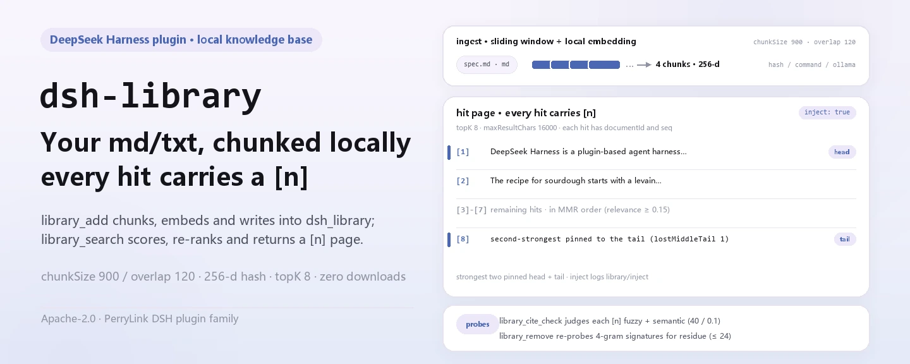

<div align="center">

<picture>
  <source media="(prefers-color-scheme: dark)" srcset="docs/assets/dsh-library-hero-en-dark.webp">
  
</picture>

# dsh-library

**Transforme seus documentos md/txt locais em uma biblioteca de recuperação citável e verificável.**

Uma base de conhecimento local de documentos para DeepSeek Harness: importe por caminho, fatie com janela deslizante, incruste localmente e obtenha resultados de busca híbrida cujas citações `[n]` — e cujas remoções — podem ser conferidas.

[Instalar](#instalação-em-três-passos) · [Configuração](#configuração) · [FAQ](#faq) · [简体中文](README.md) · [English](README.en.md) · [Español](README.es.md) · [Português](README.pt.md) · [हिन्दी](README.hi.md)

[](LICENSE)
[](#compatibilidade)
[](https://www.npmjs.com/package/dsh-library)
[](https://github.com/PerryLink/dsh-library/actions/workflows/ci.yml)
[](#compatibilidade)

[](https://github.com/PerryLink/dsh-library/stargazers)
[](https://www.npmjs.com/package/dsh-library)
[](https://dshfind.com/plugins/PerryLink/dsh-library?ref=badge)
[](https://securityscorecards.dev/viewer/?uri=github.com/PerryLink/dsh-library)
[](https://dsh.market/)
[](https://gitee.com/perrylink/dsh-library)

```sh
dsh plugin --profile <name> add dsh-library
```

</div>

<sub>Plugin da comunidade, sem afiliação com a DeepSeek. Repositório canônico: <https://github.com/PerryLink/dsh-library> (o Gitee é um espelho).</sub>

## O que é

O `dsh-library` transforma seus documentos md/txt em uma base de conhecimento local que seu agente pode consultar. O `library_add` lê um documento por caminho, fatia com janela deslizante e grava no domínio de armazenamento `dsh_library` do host; o `library_search` combina pontuação semântica e por palavras-chave, re-ranking por diversidade de máxima relevância marginal, filtragem por relevância e evitação do lost-in-the-middle para devolver uma página de resultados marcada com fontes `[n]`. As citações são conferidas uma a uma com o `library_cite_check`, e as remoções são sondadas em busca de resíduos pela verificação de expurgo do `library_remove`. Zero downloads de modelos e zero requisições de rede por padrão: a pontuação é hash determinístico e matemática de tokens.

<picture>
  <source media="(prefers-color-scheme: dark)" srcset="docs/assets/dsh-library-flow-v5-dark.svg">
  
</picture>

## Instalação em três passos

1. **Instale** (escolha um canal):

   ```sh
   # canal git (último main) — o script prepare compila apenas com dependências de produção
   dsh plugin --profile web add github:PerryLink/dsh-library
   # canal npm (versões publicadas)
   dsh plugin --profile web add dsh-library
   # canal tarball: pnpm pack neste repositório e então
   dsh plugin --profile web add ./dsh-library-<version>.tgz
   ```

   > Se o pnpm informar `ERR_PNPM_IGNORED_BUILDS` para este pacote (a validação inofensiva do binário de plataforma do esbuild), adicione `allowBuilds: { esbuild: true }` ao seu `pnpm-workspace.yaml` — o CLI `dsh` imprime o trecho exato.

2. **Configuração mínima**: os padrões bastam — o patch do bundle insere a linha `dsh-library` e o índice vive no domínio de armazenamento `dsh_library` do host (backend JSON ou SQLite). Você só precisa de uma sobrescrita para mudar o critério de recuperação; veja Configuração.

3. **Verifique se monta**:

   ```sh
   dsh --profile web --dump-config | grep -A2 'id: dsh-library'
   ```

   Depois peça ao agente para importar e usar um documento:

   ```text
   > Adicione ./docs/spec.md à biblioteca docs e responda: o que a spec diz sobre retentativas? Cite com marcadores [n].
   ```

**Desinstalar**: `dsh plugin --profile web remove dsh-library` (ou remova a linha do patch do perfil).

<details>
<summary>Instalar a partir do mercado do DSH Desktop</summary>

Todos os plugins do PerryLink podem ser explorados no mercado embutido do DSH Desktop: **Market → Sources → add source → colar** `https://perrylink-dsh-catalog.perrylink.workers.dev/catalog-source.json` **→ selecionar**. A instalação continua passando pela verificação de identidade npm do mercado e pela sua confirmação.

</details>

## Capacidades principais

O `dsh-library` transforma documentos md/txt locais em uma base de conhecimento consultável com um pipeline de qualidade em que seu agente pode confiar:

- **`library_add` / `library_remove` / `library_list`** — importa um documento por caminho (fatiado e incrustado), remove um com **verificação de expurgo** (as assinaturas do conteúdo removido são sondadas contra o índice restante e qualquer resíduo é reportado) e lista os metadados dos documentos.
- **`library_search`** — ranking híbrido semântico + palavras-chave, re-ranking por diversidade de máxima relevância marginal, filtragem por relevância e **evitação do lost-in-the-middle** (os chunks mais fortes fixados na cabeça e na cauda). Com `inject: true` a página de resultados é injetada no agente que chama; cada resultado carrega um marcador `[n]` e a injeção é reconstruível a partir do evento de sessão `library/inject` (condicionado pelo host; ver Permissões e dados).
- **`library_cite_check`** — verifica as citações `[n]` de uma resposta contra a página de resultados com uma correspondência difusa de tokens E uma checagem de similaridade semântica.
- **`library_diagnose`** — histograma de tamanhos de chunk, pares de chunks quase duplicados, uma sonda de auto-recuperação e o sinal de penalidade do meio.
- **`/library`** — resumos do índice por biblioteca em uma linha.

### Superfície de comandos e ferramentas

| Ferramenta | Notas |
|---|---|
| `library_add` | `{ path, library, name? }` → id do documento; leitura pelo serviço de arquivos do harness |
| `library_remove` | `{ library, documentId }` → resumo da remoção + veredicto de expurgo (resíduo reportado) |
| `library_list` | `{ library? }` → metadados dos documentos (nunca texto) |
| `library_search` | `{ query, library, topK?, inject? }` → resultados ordenados com marcadores `[n]`; `inject: true` semeia o agente chamador |
| `library_cite_check` | `{ library, query, answer }` → veredictos por citação válida/inválida (difuso + semântico) |
| `library_diagnose` | `{ library }` → estatísticas de chunks, duplicados, auto-recuperação, penalidade do meio |
| `/library [name]` | Comando: resumos de documentos/chunks por biblioteca |

### Exemplos

São os pontos de entrada reais; instale e chame um.

**Exemplo detalhado**

**Comando**

~~~sh
library_search({ library: "docs", query: "what is the harness built on", inject: true })
~~~

**Saída**

~~~text
Library docs: 2 result(s) for "what is the harness built on"
[1] DeepSeek Harness is a plugin-based agent harness built on vendored Cordis. Everything in the harness is a plugin row inside a cordis.yml composition. The tools/pre-execute waterfall lets plugins gate…
[2] The recipe for sourdough starts with a levain fed the night before. Bulk fermentation takes four to six hours at room temperature. Bake in a dutch oven at 230 degrees Celsius for the first twenty min…
~~~

*Observed from `README.md:161-167; tests/index.spec.ts:46-64; src/index.ts:830-836`*

**Ramo de falha**

**Entrada**

~~~text
{"path":"/nonexistent/dsh-library-missing.txt","library":"docs"}
~~~

**Saída**

~~~text
isError=true; error.message=cannot read "/nonexistent/dsh-library-missing.txt": not found; error.info={"name":"FsError","code":"FS_NOT_FOUND"}
~~~

*Observed from `plugins/dsh-library/src/index.ts:695-696 (fs.resolve/readText); plugins/dsh-library/tests/index.spec.ts:143-151 (unreadable path); plugins/dsh-library/README.md:195 (unreadable files fail loud); exercised through plugins/dsh-library/tests/harness.ts`*

**Exemplos breves**: `library_search` · `library_list`

## Configuração

Todos os ajustes são campos `Config` do Schemastery (alteráveis pelo cordis.yml). Uma sobrescrita direcionada por id substitui a linha inteira — redeclare cada chave que precisar. O `cordis.patch.yml` documenta cada chave em linha.

Chaves mais usadas:

| Chave | Padrão | Significado |
|---|---|---|
| `chunkSize` | `900` | Tamanho do chunk em caracteres (janela deslizante, ≤ 4000) |
| `chunkOverlap` | `120` | Sobreposição entre janelas; deve ser menor que `chunkSize` |
| `maxFileBytes` | `5242880` | Arquivos maiores são rejeitados no `library_add` |
| `embedding.provider` | `hash` | Backend do embedder: `hash` (integrado, zero downloads), `command` (subprocesso externo, requer `embedding.command`), `ollama` (Ollama local, sondado e degradado para `hash` se inalcançável) |
| `search.topK` | `8` | Resultados devolvidos após o pipeline completo |
| `search.hybridWeight` | `0.6` | 0 = só palavras-chave, 1 = só semântica |
| `search.minRelevance` | `0.15` | Chunks abaixo deste limiar de relevância são filtrados |
| `injection.enabled` / `maxChars` | `true` / `12000` | Comportamento e orçamento de injeção do `library_search` |

<details>
<summary>Tabela completa de configuração (18 grupos de chaves)</summary>

| Chave | Padrão | Significado |
|---|---|---|
| `chunkSize` | `900` | Tamanho do chunk em caracteres (janela deslizante, ≤ 4000) |
| `chunkOverlap` | `120` | Sobreposição entre janelas; deve ser menor que `chunkSize` |
| `maxFileBytes` | `5242880` | Arquivos maiores são rejeitados no `library_add` |
| `embedding.dims` | `256` | Dimensionalidade do hash embedding (≥ 8) |
| `embedding.provider` | `hash` | Backend do embedder: `hash` (integrado, zero downloads), `command` (subprocesso externo, requer `embedding.command`), `ollama` (Ollama local, sondado e degradado para `hash` se inalcançável) |
| `embedding.command` | `''` | Comando de embedder externo opcional (argv separado por espaços, sem shell) via `ctx.subprocess`; configurá-lo seleciona o backend `command` |
| `embedding.ollamaUrl` / `ollamaModel` | `http://127.0.0.1:11434` / `nomic-embed-text` | Endpoint e modelo do Ollama local para o backend `ollama` (zero nuvem) |
| `embedding.timeoutMs` / `graceMs` / `maxOutputBytes` / `maxBatchItems` | `30000` / `1000` / `1048576` / `64` | Orçamento do subprocesso do embedder |
| `search.topK` | `8` | Resultados devolvidos após o pipeline completo |
| `search.hybridWeight` | `0.6` | 0 = só palavras-chave, 1 = só semântica |
| `search.minRelevance` | `0.15` | Chunks abaixo deste limiar de relevância são filtrados |
| `search.diversityLambda` | `0.5` | Compensação MMR: 1 = relevância pura, 0 = diversidade pura |
| `search.lostMiddleHead` / `lostMiddleTail` | `1` / `1` | Chunks mais fortes fixados na cabeça / cauda |
| `search.maxResultChars` | `16000` | Orçamento de caracteres da página de resultados |
| `injection.enabled` / `maxChars` | `true` / `12000` | Comportamento e orçamento de injeção do `library_search` |
| `citation.windowChars` / `minScore` / `minSemantic` | `150` / `40` / `0.1` | Limiares do `library_cite_check` |
| `purge.signatureLength` / `maxProbes` | `4` / `24` | Assinaturas e orçamento de sondas da verificação de expurgo |
| `diagnose.maxDuplicatePairs` / `sampleCap` / `positionBins` | `24` / `200` / `5` | Limites do `library_diagnose` |

</details>

Exemplo de sobrescrita no patch do seu perfil:

```yaml
- insert:
    - id: dsh-library
      name: dsh-library
      config:
        chunkSize: 900
        embedding:
          provider: ollama
          ollamaModel: nomic-embed-text
        search:
          hybridWeight: 0.7
```

## FAQ

<details>
<summary>Onde o texto dos documentos e o índice realmente vivem? Podem chegar ao registro de sessão?</summary>

O texto dos chunks e os embeddings vivem no backend de armazenamento do host (JSON ou SQLite), com a mesma confiança do restante dos dados duráveis da implantação; o plugin não adiciona criptografia. Caminhos de documentos e embeddings nunca entram no registro de sessão — `library/inject` (id, consulta, ids de chunks, tamanho da página) e `library/purge` (veredicto) são eventos de auditoria somente-registro, e a página injetada visível ao modelo é reconstruível a partir deles. Em hosts que não registram nenhum desses tipos, os eventos registrados `tool/call` + `tool/result` continuam sendo a trilha de auditoria reconstruível.

</details>

<details>
<summary>Funciona sem modelo ou rede?</summary>

Sim. O embedder embutido é hash determinístico (tokens de palavra mais trigramas de caracteres em um vetor de baldes com sinal, normalizado L2), então há zero downloads e zero requisições de rede; a pontuação é hash e matemática de tokens. A contrapartida é semântica de grau lexical: a qualidade de recuperação em paráfrases é menor que com um modelo real — configure `embedding.command` (qualquer embedder de subprocesso) ou `embedding.provider: ollama` (um modelo Ollama local) para semântica mais forte.

</details>

<details>
<summary>Um documento removido realmente desaparece?</summary>

O `library_remove` não assume sucesso: sonda o índice restante com assinaturas determinísticas do conteúdo removido (`purge.signatureLength`, no máximo `purge.maxProbes` sondas) e reporta o resíduo em vez de afirmar que expurgou.

</details>

<details>
<summary>Ele briga com outros plugins por nomes de ferramentas ou serviços?</summary>

Não. Ele só consome serviços do host (`storageDomain` / `tools` / `commands`); toda ferramenta que registra carrega o prefixo `library_`, seu único comando é `/library`, não registra nenhum listener de waterfall e não oferece nenhuma chave de serviço pela qual outro plugin possa competir, então não ocupa nenhum nome de ferramenta nu.

</details>

<details>
<summary>Qual é o tamanho do custo de desempenho?</summary>

O caminho padrão não faz chamadas a modelos nem requisições de rede; o custo é uma passada de fatiamento com janela deslizante mais o hash embedding, e depois a pontuação e o re-ranking na consulta. Os limites são configuráveis: `maxFileBytes` limita o tamanho do documento, `search.topK` limita os resultados, `search.maxResultChars` e `injection.maxChars` limitam o orçamento de texto visível ao modelo, e o `library_diagnose` mostra a distribuição de chunks e os duplicados sob demanda.

</details>

## Limites de segurança

- **Local por padrão.** Zero downloads de modelos, zero chamadas de rede — a pontuação é hash determinístico e matemática de tokens. Apenas um comando de embedder configurado explicitamente executa código, e seu protocolo é verificado por completude e limitado em saída.
- **Sem fabricação.** As checagens de citações informam o que o pipeline pode verificar; citações suspeitas são exibidas com honestidade, nunca adivinhadas.
- **O expurgo é verificado.** O `library_remove` sonda o índice restante com assinaturas determinísticas do conteúdo removido e reporta o resíduo em vez de assumir sucesso.
- **Falha ruidosa.** Nomes de biblioteca inválidos, documentos grandes demais, arquivos ilegíveis e um seam de embedder configurado mas ausente falham com erro claro.

## Permissões e dados

- **Permissões**: o plugin só lê os arquivos apontados pelo `library_add` (pelo serviço de arquivos do harness e sua política) e escreve no seu próprio domínio de armazenamento `dsh_library`. Sem requisições de rede; um embedder externo opcional executa via `ctx.subprocess` sem interpretação de shell.
- **Dados**: o texto dos chunks e os embeddings vivem no backend de armazenamento do host (a mesma confiança do restante dos dados duráveis da implantação); o plugin não adiciona criptografia. Caminhos de documentos e embeddings nunca entram no registro de sessão.
- **Registro de sessão**: `library/inject` (id, consulta, ids de chunks, tamanho da página) e `library/purge` (veredicto) são eventos de auditoria somente-registro — a página injetada visível ao modelo é reconstruível a partir deles. O append é condicionado pelo host: harnesses cujo conjunto de tipos conhecidos cobre o vocabulário recebem os eventos, builds com envelope `ignorable` os recebem com o marcador, e builds sem envelope (0.1.1-rc.2, 0.1.2-rc.1) pulam o append — ali, os eventos registrados `tool/call` + `tool/result` continuam sendo a trilha de auditoria reconstruível.
0.1.2-rc.1 (adaptado em 2026-09-02): o envelope de sessão mantém seu campo ignorable apenas para compatibilidade de leitura de logs armazenados - o Session.append ainda não consegue estampá-lo, então o comportamento da porta não muda.

## Limitações conhecidas

- **Embeddings de grau lexical.** O embedder hash integrado pontua similaridade superficial, não significado; a qualidade de recuperação em paráfrases é menor que com um modelo real — configure `embedding.command` (qualquer embedder de subprocesso) ou `embedding.provider: ollama` (um modelo de embedding Ollama local) para semântica mais forte.
- **Modelo de citação local.** O `library_cite_check` valida contra a página de resultados (a numeração `[n]`), não contra nomes de fonte livres; a pontuação difusa é uma razão parcial de sequências de tokens limitada.
- **Sem pipeline de ingestão.** Os documentos devem ser importados por caminho (`md`/`txt`); a extração de PDF/docx fica fora da v0.1.0.
- **Eventos de auditoria condicionados pelo host.** `library/inject` / `library/purge` só são gravados em harnesses que podem carregá-los (veja Permissões e dados); na linha publicada `0.1.2-rc.1` (como nas linhas sem envelope anteriores) eles não são gravados, e cada fato continua reconstruível a partir do registro de chamada/resultado da ferramenta.

## Compatibilidade

| Superfície | Estado |
|---|---|
| Harness | DeepSeek Harness `dsh-v0.2.1-alpha.1` (verificado em 2026-09-25: dupla checagem de tipos + 89 testes + portas self-contained/artifacts; faixa de peers `>=0.1.2-rc.1 <0.2.0 \|\| >=0.1.5-alpha.1 <0.2.0 \|\| >=0.1.6-0 <0.2.0 \|\| >=0.1.7-0 <0.2.0`). Único pacote da família com um smoke real de host alpha.2 (2026-09-11). |
| Node | `^22.19.0 \|\| >=24.0.0` |
| Armazenamento | Qualquer backend de storage-domain (JSON ou SQLite); o índice vive no domínio de armazenamento do host |
| Modelos | Nenhum obrigatório — o embedder embutido é hash determinístico (zero downloads) |

## Ecossistema e qualidade

- [Espelho no Gitee](https://gitee.com/perrylink/dsh-library) (espelho sincronizado; o GitHub é o canônico)
- [Página do plugin no dshfind](https://dshfind.com/plugins/PerryLink/dsh-library) (instalações e ranking)
- [Relatório do OpenSSF Scorecard](https://securityscorecards.dev/viewer/?uri=github.com/PerryLink/dsh-library) (impulsionado por [.github/workflows/scorecard.yml](.github/workflows/scorecard.yml))
- [Relatório de verificação do dsh-plugin-doctor](https://github.com/PerryLink/dsh-plugin-doctor#verified-徽章)
- [DSH Market](https://dsh.market/) (listado)
- **Canal da loja 1024**: `npm i -g dsh1024` uma vez, depois `dsh1024 plugin --profile web add dsh-library` (conta para o ranking de instalações do [deepseek1024.com](https://deepseek1024.com))
- [Base de conhecimento do ecossistema](https://perrylink.github.io/dsh-plugin-guide/) — dados medidos, não marketing: guia de desenvolvimento · dados de seleção · critérios de manutenção

## Desenvolvimento

```sh
pnpm install        # node ^22.19 || >=24
pnpm run typecheck  # tsc: src + tests contra o checkout local do harness
pnpm run typecheck:ci  # tsc contra os tipos publicados 0.1.7-rc.2 (sem paths)
pnpm test           # vitest: portas de qualidade, vocabulário núcleo, montagem com pilha real
pnpm run build      # bundle tsdown + declarações tsc (lib/)
pnpm run verify:self-contained  # especificações de dependências resolvem pelo registry
pnpm run verify:artifacts       # face ESM construída + bundle patch presente
pnpm run check:readmes          # consistência dos README em cinco idiomas
pnpm pack           # o tarball publicado
```

As imagens do README são geradas programaticamente por [`scripts/gen-readme-assets.py`](scripts/gen-readme-assets.py): o Pillow desenha os banners hero (`docs/assets/dsh-library-hero-{zh,en}-{light,dark}.webp`) e um SVG escrito à mão desenha o diagrama de estrutura (`docs/assets/dsh-library-flow-v5-{light,dark}.svg`); ambos podem ser executados novamente sem risco. O diagrama de fluxo antigo de painel único fica em `docs/assets/` para links externos; os READMEs só referenciam os novos pares hero e flow-v5.

Topics: `dsh`, `dsh-plugin`, `deepseek-harness`, `deepseek`, `cordis`, `rag`, `knowledge-base`, `retrieval`, `embedding`, `vector-search`, `citation-validation`, `document-library`

## Família e agradecimentos

Este projeto faz parte da família de plugins de DeepSeek Harness do [PerryLink](https://github.com/PerryLink) (95 plugins, todos Apache-2.0). Se ele for útil, **deixe uma estrela** — nada fica bloqueado por trás disso, mas ajuda a próxima pessoa a encontrá-lo.

- [@PerryLink](https://github.com/PerryLink) — criador e mantenedor: as oito portas de qualidade, o índice de domínio de armazenamento, o pipeline de recuperação híbrido, a verificação de citações/expurgo e a documentação em cinco idiomas.

<details>
<summary>Expandir todos os plugins</summary>

| Plugin | Estado |
|---|---|
| **[dsh-aqua-input-check](https://github.com/PerryLink/dsh-aqua-input-check)** |  |
| **[dsh-archive-check](https://github.com/PerryLink/dsh-archive-check)** |  |
| **[dsh-auto-review](https://github.com/PerryLink/dsh-auto-review)** |  |
| **[dsh-autotier](https://github.com/PerryLink/dsh-autotier)** | 🧊 CONGELADO — ver o README do repo |
| **[dsh-bid-ca-precheck](https://github.com/PerryLink/dsh-bid-ca-precheck)** |  |
| **[dsh-bid-qual-check](https://github.com/PerryLink/dsh-bid-qual-check)** |  |
| **[dsh-cert-mcp](https://github.com/PerryLink/dsh-cert-mcp)** | 🧊 CONGELADO — ver o README do repo |
| **[dsh-checkpoint-rewind](https://github.com/PerryLink/dsh-checkpoint-rewind)** |  |
| **[dsh-click](https://github.com/PerryLink/dsh-click)** |  |
| **[dsh-composer-history](https://github.com/PerryLink/dsh-composer-history)** |  |
| **[dsh-contract-stance](https://github.com/PerryLink/dsh-contract-stance)** |  |
| **[dsh-customs-doc-check](https://github.com/PerryLink/dsh-customs-doc-check)** |  |
| **[dsh-data-quality](https://github.com/PerryLink/dsh-data-quality)** | 🧊 CONGELADO — ver o README do repo |
| **[dsh-demurrage-ledger](https://github.com/PerryLink/dsh-demurrage-ledger)** |  |
| **[dsh-doublecheck](https://github.com/PerryLink/dsh-doublecheck)** |  |
| **[dsh-drill-script-check](https://github.com/PerryLink/dsh-drill-script-check)** |  |
| **[dsh-eia-guide-check](https://github.com/PerryLink/dsh-eia-guide-check)** |  |
| **[dsh-emergency-plan](https://github.com/PerryLink/dsh-emergency-plan)** |  |
| **[dsh-essay-rubric-check](https://github.com/PerryLink/dsh-essay-rubric-check)** |  |
| **[dsh-evidence-check](https://github.com/PerryLink/dsh-evidence-check)** |  |
| **[dsh-export-ctl-check](https://github.com/PerryLink/dsh-export-ctl-check)** |  |
| **[dsh-fast](https://github.com/PerryLink/dsh-fast)** |  |
| **[dsh-fmea-table-check](https://github.com/PerryLink/dsh-fmea-table-check)** |  |
| **[dsh-forecast-penalty](https://github.com/PerryLink/dsh-forecast-penalty)** |  |
| **[dsh-fund-research](https://github.com/PerryLink/dsh-fund-research)** |  |
| **[dsh-github](https://github.com/PerryLink/dsh-github)** |  |
| **[dsh-gongwen-flow-check](https://github.com/PerryLink/dsh-gongwen-flow-check)** |  |
| **[dsh-gongwen-word-check](https://github.com/PerryLink/dsh-gongwen-word-check)** |  |
| **[dsh-guard-plan-qc](https://github.com/PerryLink/dsh-guard-plan-qc)** |  |
| **[dsh-hazchem-check](https://github.com/PerryLink/dsh-hazchem-check)** |  |
| **[dsh-hazplan-check](https://github.com/PerryLink/dsh-hazplan-check)** |  |
| **[dsh-hidden-risk-map](https://github.com/PerryLink/dsh-hidden-risk-map)** |  |
| **[dsh-hs-classify](https://github.com/PerryLink/dsh-hs-classify)** |  |
| **[dsh-icd-rule-check](https://github.com/PerryLink/dsh-icd-rule-check)** |  |
| **[dsh-industry-research](https://github.com/PerryLink/dsh-industry-research)** |  |
| **[dsh-lawcite-adapter](https://github.com/PerryLink/dsh-lawcite-adapter)** |  |
| **[dsh-laya](https://github.com/PerryLink/dsh-laya)** |  |
| **[dsh-lc-doc-check](https://github.com/PerryLink/dsh-lc-doc-check)** |  |
| **[dsh-learning-gap-check](https://github.com/PerryLink/dsh-learning-gap-check)** |  |
| **[dsh-library](https://github.com/PerryLink/dsh-library)** |  |
| **[dsh-local-ai](https://github.com/PerryLink/dsh-local-ai)** |  |
| **[dsh-lsp-actions](https://github.com/PerryLink/dsh-lsp-actions)** |  |
| **[dsh-mask](https://github.com/PerryLink/dsh-mask)** |  |
| **[dsh-mcp-panel](https://github.com/PerryLink/dsh-mcp-panel)** |  |
| **[dsh-medrec-qc](https://github.com/PerryLink/dsh-medrec-qc)** |  |
| **[dsh-memento](https://github.com/PerryLink/dsh-memento)** | 🧊 CONGELADO — ver o README do repo |
| **[dsh-nsfc-form-check](https://github.com/PerryLink/dsh-nsfc-form-check)** |  |
| **[dsh-nurse-record-check](https://github.com/PerryLink/dsh-nurse-record-check)** |  |
| **[dsh-observe](https://github.com/PerryLink/dsh-observe)** |  |
| **[dsh-origin-rvc-check](https://github.com/PerryLink/dsh-origin-rvc-check)** |  |
| **[dsh-ota-review-check](https://github.com/PerryLink/dsh-ota-review-check)** |  |
| **[dsh-output-styles](https://github.com/PerryLink/dsh-output-styles)** |  |
| **[dsh-paper-doc-adapter](https://github.com/PerryLink/dsh-paper-doc-adapter)** |  |
| **[dsh-permission-rules](https://github.com/PerryLink/dsh-permission-rules)** |  |
| **[dsh-permit-report-check](https://github.com/PerryLink/dsh-permit-report-check)** |  |
| **[dsh-pipeline-check](https://github.com/PerryLink/dsh-pipeline-check)** |  |
| **[dsh-pleading-draft](https://github.com/PerryLink/dsh-pleading-draft)** |  |
| **[dsh-plugin-doctor](https://github.com/PerryLink/dsh-plugin-doctor)** | 🚫 APOSENTADO (repo arquivado) |
| **[dsh-plugin-guide](https://github.com/PerryLink/dsh-plugin-guide)** |  |
| **[dsh-plugin-kit](https://github.com/PerryLink/dsh-plugin-kit)** | 🚫 APOSENTADO (repo arquivado) |
| **[dsh-plugin-upgrade](https://github.com/PerryLink/dsh-plugin-upgrade)** | 🚫 APOSENTADO (repo arquivado) |
| **[dsh-policy-brief-draft](https://github.com/PerryLink/dsh-policy-brief-draft)** |  |
| **[dsh-power-loss-split](https://github.com/PerryLink/dsh-power-loss-split)** |  |
| **[dsh-power-ticket-check](https://github.com/PerryLink/dsh-power-ticket-check)** |  |
| **[dsh-ppap-check](https://github.com/PerryLink/dsh-ppap-check)** |  |
| **[dsh-protest-deadline](https://github.com/PerryLink/dsh-protest-deadline)** |  |
| **[dsh-railway-window](https://github.com/PerryLink/dsh-railway-window)** |  |
| **[dsh-repair-order-qc](https://github.com/PerryLink/dsh-repair-order-qc)** |  |
| **[dsh-research-report](https://github.com/PerryLink/dsh-research-report)** |  |
| **[dsh-review-reply-check](https://github.com/PerryLink/dsh-review-reply-check)** |  |
| **[dsh-rulefile-check](https://github.com/PerryLink/dsh-rulefile-check)** |  |
| **[dsh-safety-brief-check](https://github.com/PerryLink/dsh-safety-brief-check)** |  |
| **[dsh-score](https://github.com/PerryLink/dsh-score)** | 🧊 CONGELADO — ver o README do repo |
| **[dsh-session-sync](https://github.com/PerryLink/dsh-session-sync)** |  |
| **[dsh-site-log-check](https://github.com/PerryLink/dsh-site-log-check)** |  |
| **[dsh-skill-pack-security](https://github.com/PerryLink/dsh-skill-pack-security)** |  |
| **[dsh-soe-decision-check](https://github.com/PerryLink/dsh-soe-decision-check)** |  |
| **[dsh-soilwater-check](https://github.com/PerryLink/dsh-soilwater-check)** |  |
| **[dsh-sop-sync-check](https://github.com/PerryLink/dsh-sop-sync-check)** |  |
| **[dsh-spc-gbt-adapter](https://github.com/PerryLink/dsh-spc-gbt-adapter)** |  |
| **[dsh-talk](https://github.com/PerryLink/dsh-talk)** |  |
| **[dsh-tender-extract](https://github.com/PerryLink/dsh-tender-extract)** |  |
| **[dsh-tender-matrix](https://github.com/PerryLink/dsh-tender-matrix)** |  |
| **[dsh-test-drive](https://github.com/PerryLink/dsh-test-drive)** |  |
| **[dsh-ticktick](https://github.com/PerryLink/dsh-ticktick)** | 🚫 APOSENTADO (repo arquivado) |
| **[dsh-translate](https://github.com/PerryLink/dsh-translate)** |  |
| **[dsh-warranty-calc](https://github.com/PerryLink/dsh-warranty-calc)** |  |
| **[dsh-budget](https://github.com/PerryLink/dsh-budget)** | 🧊 CONGELADO — ver o README do repo |
| **[dsh-claude-move](https://github.com/PerryLink/dsh-claude-move)** | 🧊 CONGELADO — ver o README do repo |
| **[dsh-defend](https://github.com/PerryLink/dsh-defend)** | 🧊 CONGELADO — ver o README do repo |
| **[dsh-draw](https://github.com/PerryLink/dsh-draw)** | 🧊 CONGELADO — ver o README do repo |
| **[dsh-reach](https://github.com/PerryLink/dsh-reach)** | 🧊 CONGELADO — ver o README do repo |
| **[dsh-background-agents](https://github.com/PerryLink/dsh-background-agents)** | 🚫 APOSENTADO (repo arquivado) |
| **[dsh-session-pin](https://github.com/PerryLink/dsh-session-pin)** | 🚫 APOSENTADO (repo arquivado) |
| **[dsh-team-rooms](https://github.com/PerryLink/dsh-team-rooms)** | 🚫 APOSENTADO (repo arquivado) |

</details>

## Licença

[LICENSE](LICENSE) (Apache License 2.0) © 2026 dsh-library contributors

<p align="center"><sub>Apache-2.0 · Plugin da comunidade, sem afiliação com a DeepSeek.</sub></p>
